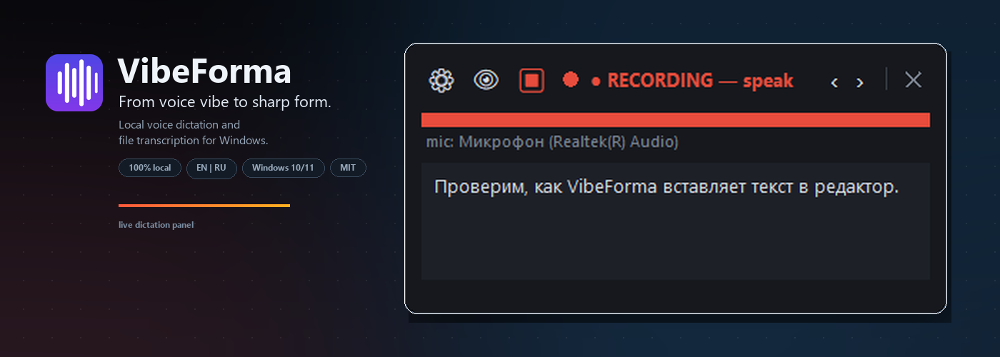

<p align="center">
  <a href="https://vibeforma.pro">
    
  </a>
</p>

<h1 align="center">VibeForma</h1>

<p align="center">
  <strong>From voice vibe to sharp form.</strong><br>
  Local voice dictation and file transcription for Windows — no cloud, no account, no telemetry.
</p>

<p align="center">
  <a href="https://github.com/FormaMindPro/vibeforma/actions/workflows/ci.yml"></a>
  <a href="https://github.com/FormaMindPro/vibeforma/releases"></a>
  <a href="LICENSE"></a>
  
  
  
  
  <a href="https://vibeforma.pro"></a>
</p>

<p align="center">
  <strong>English</strong> ·
  <a href="README.ru.md">Russian</a> ·
  <a href="https://vibeforma.pro">Website</a> ·
  <a href="https://vibeforma.pro/introduction/">Documentation</a> ·
  <a href="https://vibeforma.pro/comparison/">Comparison</a> ·
  <a href="https://github.com/FormaMindPro/vibeforma/releases">Releases</a> ·
  <a href="https://github.com/FormaMindPro/vibeforma/issues">Issues</a>
</p>

> **VibeForma 0.5.3** keeps a phrase alive when the clipboard is busy and rolls a failed update back to the old installation. 0.5.2 made insertion wait for the hotkey instead of racing it. See [What's new](#whats-new-in-053).

## What is VibeForma

VibeForma is a local voice dictation and file transcription app for Windows. Put the cursor where the text should go, press `Ctrl+Alt+Space`, speak, and the recognized text appears in the window you were working in — an editor, a browser, a chat, an IDE, a terminal.

Recognition runs on your machine through [faster-whisper](https://github.com/SYSTRAN/faster-whisper). The model understands about 99 languages; the interface and the pinned recognition language ship in English and Russian. Nothing is sent to a cloud account. The network is used once to download the model, and later only for optional update checks.

The same engine also transcribes audio and video files, including whole folders, into TXT, JSON, SRT or VTT with timestamps. Dictation and file jobs share one local queue, one language setting and one privacy model.

**At a glance**

| | |
| --- | --- |
| Platform | Windows 10/11 x64, ARM64 supported |
| Recognition | local faster-whisper; CUDA float16 or CPU int8 |
| Models | large-v3, large-v3-turbo, medium, small — switch without restart; saved local CT2 folders with add/use/remove and return to the built-in |
| Dictation | global hotkey, toggle or hold-to-talk, VAD auto-stop, continuous mode without the 120 s cut, `Esc` to cancel; Normal / Accurate / Fast quality presets |
| System audio | live subtitles of the default output in the panel, and the take recorded as a WAV with TXT and SRT beside it; nothing inserted |
| Languages | pinned recognition, 26 menu codes, ~99 model languages, a punctuation preset for every menu code; English/Russian UI |
| File input | mp4, mkv, mov, webm, mp3, wav, m4a, m4b, ogg, flac |
| Output | TXT, JSON, SRT, VTT cut by sentences; folder batches with a mirrored tree |
| Integrations | CLI, MCP server for AI agents, local HTTP API on `127.0.0.1`, OpenAI-compatible endpoint, job API, stdin hook |
| Own archive | dictionary, snippets, application profiles, history (opt-in, its sound a separate opt-in, per-entry re-recognition), statistics — files next to `config.json` |
| Price | free and open source, MIT |

## What's new in 0.5.3

- **Choose where system-audio recordings land.** The Recording tab now shows the folder that system-audio takes are written to, with the actual current path, and lets you change it: "Change…" opens a folder picker, "Open" reveals the folder, "Default" returns to `Documents\VibeForma\Recordings`. An unusable folder is rejected with a clear message before a take starts, so the WAV, TXT and SRT of a take always land in a folder that works.
- **A busy clipboard no longer eats the phrase.** When another program held the clipboard for a moment, the copy of the recognized text threw and the take died before any paste — the phrase was lost with nothing but a worker log line behind it. The copy now retries for a short moment and, if it still fails, ends the insert with an explicit error status; the text stays in the dictation history for a manual re-insert.
- **Holding `Esc` cancels once.** Every autorepeat press of a held `Esc` used to spawn its own cancel thread — dozens of parallel cancels, repeated notifications, log noise. The watcher now keeps a single cancel in flight and ignores autorepeat presses until it finishes; the next press after that works as usual.
- **Recording stops safely and the sound monitor comes back.** Stopping a take no longer races the audio writer, and the live system-audio monitor revives itself after a device failure instead of staying dead; a partial iteration failure is reported honestly instead of being swallowed.
- **Hand-written hotkey aliases start the service.** A `config.json` value like `control+alt+space` or `win+escape` used to kill the start — the toggle-mode parser only accepted canonical `ctrl`/`cmd`/`esc` names. One shared keymap now normalizes the aliases for the hotkey and the onboarding window alike, and reserved-combo warnings (`win+l`) still fire.
- **The installer survives Cyrillic and special-character paths.** A target folder like `C:\Users\Ivan\Soft$` (Cyrillic in the user name works too) used to break the PowerShell shortcut scripts or decode child output in the wrong codepage. Dollar, backtick, quote and wildcard-bracket characters are escaped now, child output is read as UTF-8, `~/VibeForma` expands to the home folder, a broken locale placeholder can no longer crash an error message, and a CUDA driver mismatch gives its own hints.
- **A failed update rolls back to the old installation.** If a step fails while updating an existing install, the old version now comes back whole: the previous marker is snapshotted into the backup before anything overwrites it, the backup survives a failed restore with its path written to the log, and the virtual environment is rebuilt from the restored requirements.
- **Uninstall finds shortcuts at odd paths.** Shortcut lookup escapes the `-like` wildcard metacharacters, so shortcuts are found and removed even when the install path contains `$`, a backtick, quotes or square brackets.
- **A failed model switch keeps the previous model.** Loading a new model no longer tears the recognizer down mid-flight: the replacement loads before the running state is replaced, and if it fails to load, the previous model keeps dictating instead of leaving the engine silent.
- **The hotkey survives heavy load.** Windows silently removes low-level hooks that take too long, and the handlers used to run on the hook thread itself, so a loaded machine could kill the toggle without a trace. The heavy work now runs on a worker with a queue; the hook thread only notes the press.
- **A broken config.json no longer stops the service.** A config.json that is not a dictionary (`null`, a list) used to crash the start with a TypeError; it is now read as the defaults, so the service starts and the settings window can write a fresh file.
- **The installer log moved out of the target folder.** The log is written to `%LOCALAPPDATA%\VibeForma\logs` and its handle is closed before the cleanups, so a failed install no longer blocks a retry or an uninstall.

## What's new in 0.5.2

- **Insertion waits for the hotkey instead of racing it.** A take is stopped with the same `Ctrl+Alt+Space` that starts it, and the paste could go out while the combo was still held: the window received `Ctrl+Alt+Shift+Insert`, which no app treats as paste, so the phrase silently stayed on the clipboard while the panel reported an insert. VibeForma now waits for the combo to come up — one second at most — checks the target window again and then pastes; the selected-text read at the start of a take and the `Ctrl+Z` undo wait the same way. When the wait times out, the text is deliberately left in the clipboard for a manual paste. The previous clipboard is restored after a successful paste again: the counter used to be read before the private-format writes of the same call, so every restore looked like a foreign change and was skipped.

## Quick start

Windows 10/11 x64, Python 3.10+ on `PATH`. One command in PowerShell:

```powershell
irm https://raw.githubusercontent.com/FormaMindPro/vibeforma/main/install.ps1 | iex
```

It finds Python, downloads the latest release, installs everything into `%LOCALAPPDATA%\VibeForma` (its own `.venv`, the dependencies, the speech model, shortcuts and a Settings > Apps entry) and starts the service. Press `Ctrl+Alt+Space` in any app and speak.

The installer asks where to install: press Enter for `%LOCALAPPDATA%\VibeForma`, or type another folder such as `D:\VibeForma`.

To launch it later: **Start menu → VibeForma**, the desktop shortcut, or `%LOCALAPPDATA%\VibeForma\run.cmd`. The service icon sits in the tray.

Options go after the script block:

```powershell
iex "& { $(irm https://raw.githubusercontent.com/FormaMindPro/vibeforma/main/install.ps1) } -Model large-v3 -NoRun"
```

- `-Model <name>` — install this model instead of showing the choice dialog
- `-Target <folder>` — install folder without the question (default: `%LOCALAPPDATA%\VibeForma`)
- `-Cpu` — CPU only (int8), even when CUDA is present
- `-DryRun` — print the plan and change nothing
- `-NoRun` — do not launch the service at the end

From `cmd.exe`: `powershell -c "irm https://raw.githubusercontent.com/FormaMindPro/vibeforma/main/install.ps1 | iex"`

The bootstrap installs released builds only: when no release zip can be downloaded it stops with the reason and never falls back to the main branch. Other ways to install (a release zip, a git clone), every flag and uninstall — [Install](#install).

## Features

| Area | What VibeForma does |
| --- | --- |
| Dictation | `Ctrl+Alt+Space` (remappable) starts a take; the phrase closes on a pause of silence, on the second keypress, or on release in hold-to-talk mode. Continuous mode is on by default, so a long take is cut at pauses and at 30 s with a carried tail and the 120 s limit no longer interrupts speech; the text is inserted once. `Esc` cancels. |
| Insertion | The text goes to the window that had focus when you pressed the hotkey. If the window changed, VibeForma offers paste here / copy / cancel instead of pasting into a stranger. The paste waits for the hotkey to come up, so a held combo never turns Shift+Insert into a dead shortcut. |
| Clipboard care | Layout-independent Shift+Insert; the previous clipboard is restored after 1 s if you have not copied something new; dictated text is excluded from Windows clipboard history and cloud sync. |
| Monitoring panel | Microphone level, a take clock (countdown or elapsed), VAD indicator, streaming text near-real-time, a privacy mode, a microphone button, history arrows and draft actions (Edit, Copy, Insert, Cancel). A doubtful phrase waits in the draft with uncertain words highlighted and offers **Recognize more precisely** / **Restore previous**; a language hint appears when another language leads; a system-audio take shows its last phrases as live subtitles and records the take to a WAV with TXT and SRT beside it. |
| System audio | Records the default output through WASAPI loopback (Bluetooth, USB, HDMI). The take runs without auto-stop on silence and without the 120 s cut, shows the last phrases as live subtitles, and is written to a 16-bit / 16 kHz mono WAV with TXT and SRT queued beside it on stop (default `Documents\VibeForma\Recordings`, a date subfolder); the path is shown on the panel, in the tray and in the HUD. Nothing goes to the active window, the draft or the dictation history; the same hotkey stops it, a 30 s buffer keeps memory flat, and an unavailable loopback or folder shows a clear error. Limits: over 6 h or 4 GB the take keeps its WAV but gets no transcript; `Esc` and exit close the WAV without queueing it. |
| Models | large-v3, large-v3-turbo, medium and small; a choice dialog at install; switch in settings or the tray without a restart; a failed download rolls back; `model` also accepts a folder with a converted CT2 model, loaded offline and checked before use; the Model tab keeps a list of local folders with add / use / remove / return to the built-in, and a user folder is never deleted on a switch. |
| Recognition quality | Normal (recommended) — beam 5 with the 0.0 → 0.2 fallback; Accurate — beam 10 at temperature 0; Fast — beam 1 at temperature 0. The `quality_preset` choice applies to the next final dictation pass without a restart; file transcription and live subtitles keep their own settings. |
| Languages | Recognition is pinned exactly — no auto-guessing; 26 language codes in the menu, about 99 languages in the model; every language is written in its own script; a punctuation preset covers every menu language, and a hint says "looks like X, Y is pinned" when another language leads. |
| Dictionary | Terms go into `hotwords` on every 30-second window, in their target form and by correction frequency; replacements apply to the recognized text (case-insensitive, the longest term wins); JSON import/export and a preview; **Application profiles** give one window its own terms, merged over the global ones. |
| Snippets | Spoken triggers expand into prepared text; stored in JSON; an application profile can carry its own snippets. |
| History (opt-in) | The last 100 dictations in `history.jsonl`; a table with when / chars / application / text, search and filters, multi-select delete, undo last insert, restore clipboard. `history_audio` also keeps a WAV of each take under a 200 MiB cap, deleted with its record; the tray re-recognizes the last take with a prompt and another model, and an entry with a saved WAV gets **Recognize more precisely** in the history window. Turning history off deletes the file and the saved sound. |
| Statistics | Counters of dictations and characters; numbers only, never the text. |
| File transcription | Audio and video (mp4, mkv, mov, webm, mp3, wav, m4a and more) through the same engine; PyAV decode, no external ffmpeg; TXT, JSON, SRT, VTT with timestamps; SRT and VTT are cut by sentences from word timestamps; invented phrases on silence and music are filtered; a file with word timestamps no longer fails on the library's `IndexError`. |
| Folder batches | A whole folder, optionally recursive; a mirrored output tree; existing files skipped; one broken file does not stop the batch; cancel; a progress strip. |
| Long files | Files of 60 s and longer use `BatchedInferencePipeline`; each batched segment is checked against the same thresholds and re-recognized sequentially when it fails; the prompt carries the previous block's tail; 4 GB / 6 h limits; a job queue where dictation always outranks a file job. |
| Local HTTP API | Off by default; `127.0.0.1` only; a token; `/health`, `/transcribe`, an OpenAI-compatible `/v1/audio/transcriptions` and a `/jobs` queue; `/jobs`, `/v1` and the CLI take `prompt`, `word_timestamps` and `clip_timestamps`; `verbose_json` carries segment confidence and a top-level `words[]`; discovery through `location.json`. |
| CLI | `--toggle`, `--cancel`, `--status`, `--transcribe`, `--transcribe-folder`, `--cancel-batch`, `--prompt`, `--words`, `--clip`, `--doctor`, `--selftest`, `--help`; talks to the running service over a named pipe. |
| Hook | `hook_command` receives the recognized text on stdin, without a shell, with a 1–30 s timeout; a failure never affects insertion. |
| Settings | Tabs for Recording, Hotkeys, Model & language, Dictionary, Snippets, History, Statistics, Appearance and System; Recording carries the sound source and **Recognition quality**, Model & language carries the local folder list, the Dictionary tab carries **Application profiles**, and the System tab carries **AI and automation**. Changes apply to the live service. `text_cleanup`, `dictation_context`, `history_audio`, `continuous`, `system_recordings_dir` and `actions` live in `config.json` for now. |
| Tray | Pause, input device, model, recognition language, history, re-recognize the last dictation, undo last insert, diagnostics and the logs folder; autostart with Windows. |
| Privacy | Local recognition, no accounts, no telemetry; logs without dictated text or window titles; the network only for the model download and optional update checks; history sound is opt-in and stays in the data folder. |
| Updates | A background check every 2 h (configurable, can be switched off); the running version and a **Check for updates** button in the settings header since 0.4.3; a newer release is offered, not forced; release notes in the notification; the archive is verified against `SHA256SUMS` before anything is unpacked; an update waits while a recording or a file job is running and retries by itself in `auto` mode; one click keeps your data. |
| Install and uninstall | One PowerShell command; a per-user install in `%LOCALAPPDATA%\VibeForma`; a Settings > Apps entry; `uninstall.cmd --remove-data` removes everything the installer and the app created and leaves the folder ready for a fresh install; `--keep-data` keeps models, settings, logs, history, statistics and corrections; files you put there yourself stay and are named. |
| Interface | English and Russian out of the box; drop a JSON file into `app/locales/` to add another language. |

## Why I built this

I built VibeForma because I needed to transcribe my own voice — every day, in the middle of work, without breaking flow.

The apps I tried either had no dictation at all, or implemented it differently: a different hotkey, a different model, a different idea of what happens to the text after you speak. None of them gave me the thing I actually needed: a fast, predictable tool that keeps my own archive and does not depend on an external service that may be down, change its terms, or quietly stop supporting my language.

Russian was the decisive case. Many products treat it as a second-class language, if they support it at all. I wanted Russian to be first-class: a pinned recognition language, a Russian interface, Russian documentation, and a model that does not guess.

I also wanted the same tool to turn video and audio into text — locally, on my own machine — because that is the work that accumulates: interviews, lectures, calls, films, notes to myself. The file mode, folder batches, the CLI and the local API grew from that need.

So VibeForma is deliberately local-first and Windows-first. It is small, it is honest about its limits, and it is mine — which means it is also yours, under the MIT license. If you need your voice to become text without asking a cloud for permission, this is the tool I built for that.

## How it compares

This is not a rating and not advertising. The snapshot date is **23 November 2026**; facts come from the projects' repositories and documentation. The full page with ten products and its sources is at [vibeforma.pro/comparison](https://vibeforma.pro/comparison/).

| Product | Type | Platforms | Local recognition | Dictation | File transcription | Russian UI / docs | Price / source |
| --- | --- | --- | --- | --- | --- | --- | --- |
| **VibeForma 0.5.3** | local dictation and file transcription | Windows 10/11 | Yes, faster-whisper | Yes | Yes — files and folder batches | Yes / Yes | Free, MIT |
| Handy | local dictation | Windows, macOS, Linux | Yes, Whisper | Yes | n/v | n/v / n/v | Free, open source |
| Buzz | local transcription | Windows, macOS, Linux | Yes, Whisper | No | Yes | n/v / n/v | Free, open source |
| Whispering | local or connected transcription | Windows, macOS, Linux | Yes or a provider | Yes | Yes | n/v / n/v | Free, open source |
| Superwhisper | commercial dictation | macOS, Windows, iOS, Android | Local and cloud | Yes | Yes | n/v / n/v | Subscription, closed |
| Wispr Flow | commercial dictation | macOS, Windows, iOS, Android | n/v | Yes | n/v | n/v / n/v | Subscription, closed |
| Descript | transcription and editing | macOS, Windows | n/v | No | Yes | n/v / n/v | Subscription, closed |

Legend: **n/v** means no public confirmation was found in the listed sources at the snapshot date; it does not prove the feature is absent. Prices and plans change — check the vendor's page before deciding.

### Where VibeForma is stronger

- **Windows-first.** Insertion into the window that was active at the hotkey, clipboard restoration, exclusion from Windows clipboard history and cloud sync, DPI-aware windows, a tray icon and a Settings > Apps entry. System audio comes through its WASAPI loopback, can be read as live subtitles, and is recorded to a WAV with TXT and SRT beside it.
- **Russian as a first-class language.** A pinned recognition language, endonyms in the menu, a punctuation preset for all 26 menu languages, a language hint when another language leads, a Russian interface and Russian documentation — not a translated help page bolted onto an English product.
- **A local API, a CLI, a hook and an MCP server without a cloud account.** The API listens on `127.0.0.1` only and requires a token; `location.json` publishes the actual port; the CLI talks to the running service over a named pipe; `hook_command` passes the text on stdin without a shell; the MCP server hands an agent the same transcriber over stdio without opening a port. Agents get the engine's own contract — prompt, word timestamps, a clip range, segment confidence and words with probabilities.
- **Your own archive.** Dictionary, snippets, application profiles, history and statistics live in files next to `config.json`. History is opt-in and stores text; with `history_audio` it also keeps the take's WAV, the tray can re-recognize the last one, and the history window can re-recognize one saved entry; statistics store only numbers. Nothing is uploaded.
- **Local files and folders.** Audio and video are transcribed on the same engine, with timestamps and four output formats; SRT and VTT cues follow sentences, a long file's blocks carry context, a batched segment that fails a threshold is retried, invented phrases are filtered, and `model` can point at a converted CT2 folder. No upload, no queue in someone else's cloud.
- **Exact language pinning.** The model recognizes exactly the language you set. That is more predictable for Russian and mixed-vocabulary dictation than per-phrase guessing; a hint names the language it hears without changing the setting.
- **No account, no telemetry.** There is nothing to sign in to and no server that receives audio. The network is used for the model download and optional update checks, and both are named explicitly.
- **Small and honest.** VibeForma does not pretend to be a meeting platform. Its limits are documented on a separate page and in [Where VibeForma is weaker](#where-vibeforma-is-weaker).

### Where VibeForma is weaker

- **Windows only.** There is no macOS, Linux, iOS or Android version.
- **One file at a time.** Files and folders are transcribed sequentially. Buzz, Whispering, Superwhisper and Descript are transcription-first tools and can be a better fit for high-volume batch work.
- **A long take can lose its buffered audio.** If recognition falls behind and does not take a chunk (for example on a very slow machine during a long continuous take), the engine drops the buffered audio at 240 s and writes a warning to the log instead of growing memory without bound; that piece is not transcribed.
- **System audio recordings have limits.** A take longer than 6 hours or larger than 4 GB keeps its WAV but gets no TXT or SRT, and `Esc` or exit closes the WAV without queueing the transcript. On music the live filter drops only short stop phrases and repeated loops, so other invented text can still reach the panel.
- **Punctuation is the Whisper model's.** There is no separate punctuation model: Silero text enhancement is not included because its license is non-commercial, the dependency and model add about 219 MB, and Russian quality was not confirmed (ADR 0001). Numbers come from the optional cleanup, filler words and capitals from its rules.
- **Two interface languages.** English and Russian. Commercial help centers cover many more.
- **No meetings, summaries, teams or billing.** Superwhisper, Wispr Flow and Descript cover scenarios VibeForma does not.
- **No cloud models.** Everything runs on the local machine, so a very weak CPU or GPU means slower recognition; cloud products offload that cost.
- **No mobile.** Dictation happens at a Windows desk.
- **A smaller ecosystem and a shorter track record.** The project is at 0.5.3; the commercial products have years of releases and larger support teams.
- **An unsigned installer.** Windows SmartScreen may warn; there is no code-signing certificate yet.

### How to choose

- **You work on Windows and want local dictation everywhere** → VibeForma. Start with [Quick start](#quick-start).
- **You need macOS or Linux** → Handy, VoiceInk (macOS) or Whispering.
- **You need to transcribe recorded files** → VibeForma for local files and folder batches; Buzz or Whispering for transcription-first batch work.
- **You want meetings, summaries and mobile apps** → Superwhisper, Wispr Flow or Descript.
- **You are building an editor or agent integration** → VibeForma's [MCP server](#connecting-an-ai-agent-mcp), [local API](#local-http-api-off-by-default) and [command line](#command-line-and-external-hook), or a commercial API service.
- **You need an engine, not an app** → whisper.cpp or faster-whisper directly.

## Updating

The service checks GitHub releases in the background (every 2 h by default; the switch and the interval live in Settings). The settings window header also shows the running version and a **Check for updates** button on every page (0.4.3). When a newer release is found, a blue **Update** button appears on the monitoring panel and in the tray. One click runs the same installer as the quick start, keeps the model, dictionary, history and `config.json`, and restarts the service. The archive is checked against `SHA256SUMS` before anything is unpacked, and an update waits while a recording or a file job is running — in `auto` mode it retries by itself when the work is done (0.4.4).

To update by hand, close VibeForma from the tray and run the quick-start command again. If the app lives outside the default folder, add `-Target`:

```powershell
iex "& { $(irm https://raw.githubusercontent.com/FormaMindPro/vibeforma/main/install.ps1) } -Target "D:\VibeForma"
```

The update is the same GitHub release zip as the first installation, with its `SHA256SUMS` for the check; nothing else is downloaded and no extra step is required.

## Uninstall

VibeForma is listed in **Settings > Apps** (per user, no admin rights). Uninstall it from there, or run `uninstall.cmd` in the service folder. The uninstaller removes the shortcuts, the startup entry, the Settings > Apps record and everything the installer and the app created — including the `vibeforma\` package, `mcp.cmd`, the requirements files, `status.json` and `location.json`. With `--remove-data` it also removes models, `config.json` (with your `hotwords`), logs, history and its sound, statistics and corrections, then deletes the emptied folder, so the installer accepts the same path as a fresh install. `--keep-data` keeps your data and skips the question. Files you put in the folder yourself stay and are named on screen; a top-level `.py` is treated as the application's own. Removal never follows a symbolic link or a junction out of the install folder.

## Install

Windows 10/11, Python 3.10+ (3.12+ recommended). With an NVIDIA GPU the recognition is fast (CUDA float16); without one the installer falls back to CPU (int8) and preselects the `small` model.

**One command (PowerShell, Windows 10+):**

```powershell
irm https://raw.githubusercontent.com/FormaMindPro/vibeforma/main/install.ps1 | iex
```

The bootstrap downloads the latest release together with its `SHA256SUMS`, verifies the hash, unpacks the archive and runs the installer — everything else (venv, dependencies, model, shortcuts) happens automatically. It installs a released build only: when no release zip is available it stops and explains why instead of falling back to the main branch. Without `-Model` the model is chosen in a small dialog during install. With options:

```powershell
iex "& { $(irm https://raw.githubusercontent.com/FormaMindPro/vibeforma/main/install.ps1) } -Model large-v3 -NoRun"
```

(from `cmd.exe`: `powershell -c "irm https://raw.githubusercontent.com/FormaMindPro/vibeforma/main/install.ps1 | iex"`)

**Option A — release zip:** grab `VibeForma-<version>.zip` from [Releases](../../releases), unzip, double-click `install.cmd`.

**Option B — git:**

```bat
git clone https://github.com/FormaMindPro/vibeforma.git
cd vibeforma
install.cmd
```

The installer: copies `app/` to `%LOCALAPPDATA%\VibeForma` → creates a `.venv` → installs dependencies → downloads the model (the only network step; skipped if the model is already in the shared Hugging Face cache) → writes `config.json` → creates shortcuts (desktop, Start menu and startup, branded icon) → records the product in Settings > Apps → starts the service.

Base dependencies only come from `app/requirements.txt`; the CUDA wheels (`nvidia-cublas-cu12`, `nvidia-cudnn-cu12`) are installed from `app/requirements-cuda.txt` only when CUDA is detected — a CPU install never downloads them. On CPU the dialog preselects the `small` model and `config.json` gets `device: "cpu"`, `compute_type: "int8"`; an existing config that still says `cuda` on a machine without CUDA is corrected (a console question on an interactive run, silence plus a log line when unattended). The recognition language preselects your Windows locale (`ru` on Russian Windows), `en` when the locale has no matching code; change it in the dialog or with `--language`.

If the old `%LOCALAPPDATA%\WhisperDictation` folder is found, its `config.json` (with `hotwords`) and downloaded `models` are copied into the new install, and the old desktop/startup/Start menu shortcuts are removed — so two copies never autostart. The old folder itself is copied, not deleted: remove it after the new version starts cleanly.

Before writing anything it checks Windows 10 build 1809+, x64/ARM64, Python 3.10–3.14, free space (model + 4 GB) and the target — an empty folder, an existing VibeForma install, or a folder marked by `.vibeforma-install.json` from a previous run. System folders, Program Files, drive roots and the profile root are refused. The first failed step stops the chain: no shortcuts, no config, no launch. A failed first install removes its folder; an existing install is restored from a backup. `install.log` (default `%LOCALAPPDATA%\VibeForma\logs`, override with `--log`) records every step, command and error tail, and the console prints its path. Re-running continues from the failed step — the venv, model and config already in place are reused.

Installer flags:

| Flag | Meaning |
| --- | --- |
| `--model <name>` | model to install; without it a choice dialog shows (on an existing install the configured model is kept) |
| `--language <code>` | recognition language; default: your Windows locale, `en` when it has no matching code |
| `--target <folder>` | service folder (default `%LOCALAPPDATA%\VibeForma`) |
| `--dry-run` | print the plan, execute nothing |
| `--cpu` | force CPU (int8) even with CUDA present |
| `--no-run` | don't launch the service at the end |
| `--log <file>` | install log path (default `%LOCALAPPDATA%\VibeForma\logs\install.log`) |

## First run

The first launch opens a three-step wizard. Step 1 picks the interface and recognition language. Step 2 picks the microphone: the level moves as it hears you, and "Test microphone" makes a short recording and shows the recognized text — nothing is inserted. Step 3 records the hotkey by pressing it: modifiers alone are refused, and a combination Windows already uses is only a warning. "Skip" writes the safe defaults. Reopen the wizard from the tray ("Setup wizard…") or from Settings > System; `onboarding_done` in `config.json` remembers that it ran.

## Models

| Model | Menu name | Size | Speed | Quality |
| --- | --- | --- | --- | --- |
| large-v3 | «large-v3» | 3.1 GB | baseline | best punctuation |
| large-v3-turbo | «large-v3-turbo» | 1.6 GB | fast | near large-v3 |
| medium | «medium» | 1.5 GB | ×4 vs large-v3 | medium |
| small | «small» | 0.5 GB | ×10 vs large-v3 | lower |

Pick the model during install (the dialog shows size and description); switch later in settings (the *Model & language* tab) or the tray menu. The switch downloads the new model first, reloads the service without a restart and then — at your choice — keeps the previous model on disk for fast switching back or deletes it (a model in the shared Hugging Face cache is left there; a failed download leaves the old model untouched). Models live in `%LOCALAPPDATA%\VibeForma\models\<name>` or in the shared Hugging Face cache; the service loads offline-first and only reaches the network when the model is nowhere on disk. `model` also accepts a path to a folder with a converted CT2 model: the folder is loaded with `local_files_only=True` and checked for `model.bin` with its CT2 header, `config.json`, `tokenizer.json` and the vocabulary; a broken folder stops with a named error instead of downloading the catalog model. For an offline install, put a model folder into `models\<name>` (or the shared Hugging Face cache) beforehand: the installer and the service then need no network at all.

**Local model folders.** The *Model & language* tab also keeps a short list of CT2 folders. **Add folder** checks for `model.bin` and refuses a folder without it; **Use** switches through the existing progress dialog and keeps the current model if loading fails; **Remove from the list** deletes the record only, never the files; **Return to the built-in** selects a catalog model again. The list is `model_folders` in `config.json` as name + absolute path, up to 20, and a manual path in `model` still works. Switching away from a folder never deletes it, even with *keep the previous model* off: only downloaded models inside `models\` are removed.

Measured on the 12.5 s test phrase (CUDA float16, best of 3):

| Model | Recognition | Note |
| --- | --- | --- |
| large-v3 | 1.53 s | richer punctuation |
| large-v3-turbo | 0.64 s (~2.4× faster) | all words correct, sparser punctuation |

On short phrases the real turbo speedup is below the vendor's 4–8× (a larger share of non-scaling stages); the gap widens on longer audio.

## Languages

- **Recognition**: pinned exactly — the model recognizes exactly the chosen language (default `en`; the installer preselects your Windows locale); switch in the tray or settings. No auto-detection: what you set is what is recognized. A punctuation preset exists for every one of the 26 menu languages, each written in its own script; personal terms go to `config.json → "hotwords"` and reach every 30-second window. When the pinned language looks unlikely and another language leads, the panel says "looks like X, Y is pinned" without changing the setting.
- **Menu naming**: every language is written in its own script — English, Russian, Ukrainian, German, Japanese…
- **Interface**: English and Russian ship in `app/locales/*.json`. To add yours — copy `en.json`, translate the values, save as `app/locales/<code>.json`; the language then appears in settings automatically.

## Usage

1. Start the service (desktop shortcut or autostart) — a tray icon appears, the monitoring panel opens.
2. Check the panel sees your microphone (the level bar moves when you speak; otherwise pick the device in the tray).
3. `Ctrl+Alt+Space` → speak → pause → the text is inserted into the field that had focus when you pressed the hotkey.
4. `✕` hides the panel (the tray icon stays), `⚙` opens settings.

## Privacy

- Recording and recognition are local processes. Network contacts: the first model download at install; and if auto-update is on (the default), a small check of `api.github.com` every 2 h — the interval is configurable and the check can be switched off in settings. The release zip downloads only when a newer version exists. Nothing else leaves the machine.
- Logs live in the local `logs\` folder with rotation. No telemetry, no accounts, no tokens. The log holds no dictated text and no window titles; `log_window_titles: true` in `config.json` adds the title of the paste target if you need it for a diagnosis.
- History is opt-in and stays in the data folder; `history_audio` is a second opt-in and keeps the take's WAV only there, under a 200 MiB cap, deleted with the record. System-audio takes are written to the recordings folder (or `system_recordings_dir`), never to the history; the path is shown while the take runs.
- On Windows 10+ the dictated text is marked as excluded from the clipboard history and cloud sync. The monitoring panel has a privacy mode (the eye button): the text is hidden, the mic level stays, and the status line disappears 30 s after it was set.

## What stays on disk

- `config.json` — your settings and `hotwords` (the terms you typed there);
- `models\` — downloaded Whisper models;
- `logs\` — the service log (five rotated files, 1 MB each), no dictated text and no window titles by default;
- `history.jsonl` — only with history on: the last 100 dictations (text, application, direction);
- `history_audio\` — only with `history` and `history_audio` on: a WAV of each dictation, under a 200 MiB cap, deleted with its record, the history or the option;
- `corrections.json` — learned dictionary corrections;
- `Documents\VibeForma\Recordings\` (or `system_recordings_dir`) — system-audio takes as WAV with TXT and SRT beside them; these are your files and stay outside the install folder;
- local model folders you added — wherever you put them; a switch never deletes them;
- `_http_in_*.wav` — only while the local HTTP API handles a request; deleted in any case, success or failure;
- `install.log` — the installer's own log;
- no microphone recordings are kept unless you turn `history_audio` on.

## Local HTTP API (off by default)

Turn it on in Settings → **Voice for external forms** → **Allow the local API for forms**. The key is minted and saved automatically. The API listens on `127.0.0.1` only and answers `GET /health` and `POST /transcribe` with the header `X-VibeForma-Token: <secret>`. `/health` returns `ok`, `app` (`vibeforma`), `api`, the actual `port`, `version`, `model`, `language` and `state`; `/transcribe` takes `Content-Type: audio/wav`, a WAV body up to 10 MB, one request per second, only while the service is idle, and answers `{"text": "..."}`; the uploaded audio is written to a temporary file and deleted in any case.

The service publishes `%LOCALAPPDATA%\VibeForma\location.json` with `schema` (2), `app`, `version`, `launcher`, `python`, `entry`, `install_dir`, `pipe`, `config`, `api` (`on`, `off` or `error`), `file_mode`, `formats`, `languages`, `max_file_mb`, `max_file_s` and the actual `port`. If the configured port (`8787` by default) is busy, the service binds a free loopback port and writes that port here, so a form reads the endpoint from this file instead of hardcoding a port. The file carries no secret: the pipe is protected by its own DACL and the token stays in `config.json`.

The file mode adds three kinds of routes, all on `127.0.0.1` and all with the same token:

- `GET /capabilities` - version, models, languages, formats, limits, `file_mode`, `word_timestamps`, `dictation_priority`, `prompt`, `clip_timestamps`, the pipe and the launcher;
- `POST /v1/audio/transcriptions` - OpenAI-compatible multipart (`file`, `model`, `language`, `response_format`, `prompt`, `temperature`, `word_timestamps`, `clip_timestamps`); `response_format` is `json`, `text`, `srt`, `vtt` or `verbose_json`; `verbose_json` carries `segments[].avg_logprob`, `no_speech_prob`, `compression_ratio` and `temperature` plus a top-level `words[]` with `probability`; synchronous up to `file_max_sync_s` (900 s), longer files get `413` with a pointer to `/jobs`;
- `POST /jobs`, `GET /jobs/<id>`, `DELETE /jobs/<id>` (cancel), `GET /jobs/<id>/result?format=srt|vtt|txt|json` - the queue for long files; `POST /jobs` takes `prompt`, `word_timestamps` and `clip_timestamps`, `/jobs/<id>` reports the applied contract, the answer is `202` with `Location: /jobs/<id>`, and `409` until the result is ready.

`/health` keeps its old fields and adds `file_mode`, `jobs_running`, `jobs_queued` and `dictation_priority`. The old `/transcribe` keeps its contract: 10 MB, one request per second, idle only. A dictation always outranks a file job: the job pauses between segments and resumes when the service is idle.

## Connecting an AI agent (MCP)

Settings → **AI and automation** shows the loopback endpoint, the MCP launcher and two copy buttons: the key and a ready connection block that a local AI client can be given as is. The block names the endpoint, the token, the launcher and the tools.

An MCP client starts `%LOCALAPPDATA%\VibeForma\mcp.cmd` as a stdio server:

```json
{
  "mcpServers": {
    "vibeforma": {
      "command": "C:\\Users\\<you>\\AppData\\Local\\VibeForma\\mcp.cmd"
    }
  }
}
```

The server reads `location.json` for the actual port and `config.json` for the token, so nothing has to be hardcoded. It exposes `vibeforma_capabilities`, `vibeforma_transcribe_file` and `vibeforma_job_status`; transcription queues the file through `/jobs` and returns the text when the job finishes, and the tool accepts `prompt`, `word_timestamps` and `clip_timestamps`, with the job status reporting the applied contract. The local API must be on: without it the server answers with a named refusal. The service itself stays loopback-only — the MCP server adds no listener and never sends the token anywhere.

## File transcription

Audio and video files go through the same engine as dictation: mp4, mkv, mov, webm, mp3, wav, m4a. PyAV decodes them (the dependency faster-whisper already brings), so no external ffmpeg is needed. The output is text with timestamps in TXT, JSON, SRT or VTT. With word timestamps on, SRT and VTT cues are cut by sentences: a sentence end or a pause of 0.6 s or longer closes a cue, a shorter pause glues words across engine windows and 600 s blocks; without word timestamps the engine segments stand. TXT and JSON keep their contract.

Invented text is filtered: a stop list of typical ru and en false phrases, a 2.0 s silence threshold with word timestamps and a compression-ratio guard drop a segment on silence or music when `no_speech_prob` is at least 0.6; a loop the engine still reads as speech stays and is flagged. A file with word timestamps no longer fails on faster-whisper's `find_alignment` bug: the block is retried without word timestamps and the retry is logged.

Long file jobs (60 s and longer) are transcribed in batches: several 30-second windows go through the model in one pass (`BatchedInferencePipeline`) on the same loaded model, with the same language, VAD, prompt and anti-hallucination settings. Short files and dictation stay on the sequential path. If the batched path is unavailable or fails mid-file, the job falls back to the sequential path without duplicates. Each batched segment is measured against the same thresholds as the sequential path; a segment that fails is re-recognized sequentially over its own slice of the block and the fact is logged, and the prompt carries a 200-character tail of the previous block so a name holds across the seam. The keys are `file_batched` (on by default) and `file_batch_size` (8, kept within 1-16); the speed-up depends on the device, and the measured figure on the reference machine is in `CHANGELOG.md`.

From the tray: **Transcribe file...**, pick a file, watch the progress in the panel, then use **Open result folder**. From the command line (the service must be running):

```
run.cmd --transcribe "D:\video\talk.mp4" --lang ru --format srt
run.cmd --transcribe "D:\video\talk.mp4" --format all --json
.venv\Scripts\python.exe main.py --transcribe talk.mp4 --out out\talk.srt
```

- `--lang` is the recognition language (the config value otherwise, English as the last resort);
- `--format` is `txt`, `json`, `srt`, `vtt` or `all` (default `srt`);
- `--out` writes to a named file or folder; without it the result lands beside the source with the same stem;
- `--force` allows overwriting an existing result;
- `--prompt` is the recognition hint for this file (the configured preset otherwise);
- `--words` asks for word-level timestamps and probabilities, so SRT and VTT cues follow sentences;
- `--clip START[,END]` transcribes only that range in seconds; timestamps stay absolute and a bad range exits 2;
- `--json` prints `{"ok": true, "job_id": ..., "out": [...], "segments": N, "duration_s": ...}`; progress goes to stderr.

Exit codes: `0` success, `1` the service is not running or the job failed, `2` bad arguments, `3` cancelled. While the service is still loading its first model the CLI answers `VibeForma: the model is loading` and exits 1; `VibeForma is not running` appears only when no channel listens. The request travels over the current user's named pipe (`\\.\pipe\VibeForma-<user>`), so the CLI never opens a port and never waits for the HTTP API.

Limits: `file_max_mb` (4096), `file_max_s` (6 hours), `job_keep_s` (24 hours for a finished job), `file_roots` (empty = every local fixed or removable disk; network, UNC and device paths are refused). The input file is never copied or changed. No network is used for recognition or delivery. VibeForma produces SRT/VTT; burning subtitles into a video or translating them is a downstream tool, not this engine.

## Batch folder transcription

A whole folder goes through the same engine and the same queue as one file, one file at a time. From the tray choose **Transcribe folder…** and pick a folder; from the command line (the service must be running):

```
run.cmd --transcribe-folder "D:\media" --format all --json
run.cmd --transcribe-folder "D:\media" --recursive --out D:\out
.venv\Scripts\python.exe main.py --transcribe-folder media --lang ru
```

- the default is the top level of the folder; `--recursive` adds subfolders;
- supported files: mp4, mkv, mov, webm, mp3, wav, m4a, m4b, ogg, flac; other files are not picked up and are not an error;
- without `--out` every result lands beside its source; with `--out` the folder tree is mirrored (`D:\media\sub\b.mkv` becomes `D:\out\sub\b.srt`);
- an existing output is skipped, not overwritten; `--force` overwrites it;
- two sources with the same stem (`a.mp4`, `a.mkv`) produce one target: the second file is recorded as `duplicate output target` and the batch goes on;
- one broken file is recorded and the rest continue; the batch ends with the counters and a non-zero code when anything failed;
- dictation outranks the batch: it starts at once, the batch pauses between segments and resumes on the same file;
- `--cancel-batch [<id>]` stops the current file and the queue;
- `--json` prints one summary object with `total/done/skipped/failed/cancelled/progress/files`; progress goes to stderr.

The HUD shows a bottom strip while a file or a batch runs: a moving bar, the current file name, its percent, and the batch counter `Batch: N/M — P%`. The states are visibly different (queued, transcribing, paused for dictation, done, failed), the error of one file stays visible while the batch goes on, and the result hides 8 seconds after the end. The strip does not take focus and does not touch the dictation overlay or the hotkey.

Exit codes: `0` every file done or skipped, `1` a file failed or the service is not running, `2` bad arguments or a refused folder, `3` cancelled, `4` nothing to transcribe in the folder. Network, UNC and device paths are refused; drag&drop is not a file entrance.

## For agents and other harnesses

Any harness - Forma Mind, Claude Code, Cursor, Codex, a PowerShell script or a Python process - uses the same OS-level contract; VibeForma does not know which one is calling. A harness that speaks MCP can skip the contract entirely: see [Connecting an AI agent (MCP)](#connecting-an-ai-agent-mcp).

1. Read `%LOCALAPPDATA%\VibeForma\location.json`: `launcher`, `python`, `entry` and `pipe`. No file means the service is not running.
2. Call the launcher, or the venv python with the entry file, with `--transcribe`:

```powershell
# PowerShell
& "$env:LOCALAPPDATA\VibeForma\run.cmd" --transcribe "D:\video\talk.mp4" --lang ru --format srt --json
# cmd.exe
"%LOCALAPPDATA%\VibeForma\run.cmd" --transcribe "D:\video\talk.mp4" --format srt
# Python
subprocess.run([launcher, "--transcribe", path, "--format", "srt", "--json"], check=True)
# Node.js
spawnSync(launcher, ["--transcribe", path, "--format", "srt", "--json"])
```

3. With the local API on, `POST /v1/audio/transcriptions` (short files) or `POST /jobs` (long files) do the same over HTTP; both take `prompt`, `word_timestamps` and `clip_timestamps`, and `GET /capabilities` lists formats, limits, `prompt` and `clip_timestamps`.
4. `run.cmd --help` prints the contract, so a harness needs no source file.

Python without a shell can always use the second form: `.venv\Scripts\python.exe main.py --transcribe ...`.

## Command line and external hook

The installed copy is a source copy: `run.cmd`, `main.py` and `.venv` beside them, with no packed `VibeForma.exe`. Without arguments `run.cmd` starts the panel through `pythonw.exe main.py`; with arguments it runs `python.exe main.py` with those arguments, so stdout, stderr and the exit code reach the caller. Both forms are equivalent:

```
run.cmd --toggle
run.cmd --cancel
run.cmd --status
.venv\Scripts\python.exe main.py --status
```

`--toggle` starts recording or stops it when it is running, `--cancel` drops the current recording or the panel draft, and `--status` prints the running instance's `status.json` (`state`, `version`, `pid`, `ts`) as JSON. `--prompt`, `--words` and `--clip` belong to `--transcribe` and are described under File transcription. The flags talk to the instance that is already running: with no instance, or when the status is older than 60 s, the exit code is 1; on success it is 0. `--help` prints every command.

The hook is opt-in and off while `"hook_command"` is empty. Set it in settings → System (or in `config.json` next to `"hook_timeout_s"`, default 5): the recognized text is written to the command's stdin as UTF-8. The command runs without a shell, so `&`, `|` and `>` in the text are plain characters; the timeout is kept inside 1–30 s. A failure or a timeout is logged as a status only — the text never reaches the log — and never affects insertion. The hook runs in parallel, after the text is inserted or shown as a panel draft.

## Repository layout

```
app/
  main.py              service: states, hotkey, record/recognize threads, selftest
  audio.py             16 kHz capture, level, Silero VAD, partial transcribes
  asr.py               faster-whisper: offline-first loading, transcription, model swap
  asr.py + transcript.py  file mode: PyAV decode, segments, TXT/JSON/SRT/VTT
  file_jobs.py         file job queue: dictation priority, pause, cancel, progress
  insert.py            text insertion (Shift+Insert/Ctrl+V), clipboard restore, focus
  hotkey.py            global hotkey (pynput)
  tray.py              tray icon and menu (pystray)
  hud.py               monitoring panel (tkinter, own thread)
  settings_window.py   settings dialog (tkinter)
  doctor.py            support report: --doctor, tray/settings diagnostics
  config.py            config.json, defaults, device lookup, CUDA DLL bootstrap
  i18n.py              UI strings loader (locales/*.json, en fallback)
  locales/             en.json, ru.json — drop a file to add a language
  assets/              icon.png, icon.ico
  requirements.txt     base dependencies (no CUDA wheels)
  requirements-cuda.txt  base + CUDA wheels, used only on CUDA machines
  run.cmd              launcher: no args -> pythonw main.py; args -> python.exe main.py
  uninstall.cmd        uninstaller entry point
  uninstall.py         uninstaller (stdlib): shortcuts, Settings > Apps, files
install.cmd            one-click installer
install.py             installer (python, stdlib)
```

## Troubleshooting

Start with the built-in report: `run.cmd --doctor` (or tray → **Diagnostics…**) lists Python, dependencies, model, device, microphone, hotkey, update settings, disk space and privacy switches with OK / WARN / FAIL and exits 0 or 1. The report has no dictated text and no window titles; the window has a **Copy report** button. The full guide, including the HTTP API port, disk space and SmartScreen: [docs/TROUBLESHOOTING.md](docs/TROUBLESHOOTING.md).

- **Python not found** — install from python.org (tick "Add to PATH").
- **No CUDA** — the installer picks CPU int8 automatically; prefer `--model small` on CPU.
- **The mic hears nothing** — choose the input device in the tray; the panel shows a silence warning when the level stays near zero while recording.
- **The text was not pasted after dictation** — the active window changed while you spoke. VibeForma asks where to put the text; "Copy" leaves it in the clipboard, and the tray message says so. Set "ask where to paste" off to copy silently in that case.
- **Russian layout and Ctrl+V** — pasting defaults to Shift+Insert, which is layout-independent; switchable in settings.

## Development

The test suite runs without the model, a GPU or the network. Windows CI runs the full suite; Linux CI runs the platform-independent tests (`-m "not windows"`).

```bat
python -m venv .venv
.venv\Scripts\python -m pip install -r requirements-dev.txt
.venv\Scripts\python -m pytest -q
.venv\Scripts\python tools\ruff_gate.py
```

`tools/ruff_gate.py` runs the same selection as CI and fails on any finding: the 164 findings recorded in 0.1.9 were cleaned up, so `ruff` is blocking.

### WER/CER reference

`tests/wer/manifest.json` is the local reference for the engine: 24 short ru+en recordings with the correct text (names, numbers, terms, noise, music, silence). Speech phrases are recorded into `tests/wer/` under the names in the `file` field (WAV, 16 kHz, mono); the `noise`, `music` and `silence` records must contain no speech. While the files are missing, the measurement lists them and exits 2.

```bat
.venv\Scripts\python -m pytest -q tests\test_wer_cer.py
.venv\Scripts\python tools\wer_cer.py --self-test
.venv\Scripts\python tools\wer_cer.py --transcribe
.venv\Scripts\python tools\wer_cer.py --hyp-dir out\hyp
.venv\Scripts\python tools\wer_cer.py --baseline
```

`--self-test` checks normalization, arithmetic and the manifest without recordings or a model — it is the gate. `--transcribe` recognizes the recordings with the same engine as the product; the model, device and compute type are set by `--model` (default `large-v3`), `--device` and `--compute-type` (default CPU int8). `--hyp-dir` takes ready texts `<name>.txt` instead of recognition. The report is WER and CER per file and in total over speech; for noise, music and silence it is the number of false positives. `--json` writes the same report to a file. `--baseline` measures `test_ru.wav`, prints the actual text and the baseline line. Normalization: lower case, the Russian yo letter folded to ye, punctuation to a space, integers 0–999 as words (ru and en); WER counts words, CER counts characters without spaces.

### Language of the repository

The repository is English-only outside localization resources: code, comments, logs, the changelog and commit messages are written in English. Cyrillic is allowed only in `app/locales/*.json`, the installer's Russian texts, the ru/uk ASR prompts and `README.ru.md`. `tests/test_english_only.py` enforces the rule, so a stray Cyrillic character fails the suite.

## Reviewing the code with an AI assistant

A practice worth keeping: before pushing, run the code through any AI assistant with this prompt:

```text
You are reviewing a small Python app for Windows (voice dictation,
faster-whisper). Read app/*.py, install.py and find:
1) thread and race bugs (Tk only in its own thread, dicts shared across threads);
2) resource leaks (model, audio stream, handles);
3) any place the code could touch the network without the user asking
   (privacy: the network is allowed only for the first model download and
   the release check when auto-update is on);
4) Windows platform traps (layouts, window focus, non-ASCII paths);
5) simplifications that would break a fresh clone's installation.
Answer as a list: file:line — problem — how to fix. Do not rewrite the code.
```

## License

MIT. See [LICENSE](LICENSE).

## Documentation and links

- Website — [vibeforma.pro](https://vibeforma.pro)
- Russian site — [vibeforma.pro/ru](https://vibeforma.pro/ru/)
- What is VibeForma — [vibeforma.pro/introduction](https://vibeforma.pro/introduction/)
- Installation — [vibeforma.pro/installation](https://vibeforma.pro/installation/)
- Comparison with alternatives — [vibeforma.pro/comparison](https://vibeforma.pro/comparison/)
- Updates — [vibeforma.pro/updates](https://vibeforma.pro/updates/)
- Troubleshooting — [vibeforma.pro/troubleshooting](https://vibeforma.pro/troubleshooting/)
- Releases — [github.com/FormaMindPro/vibeforma/releases](https://github.com/FormaMindPro/vibeforma/releases)
- Issues — [github.com/FormaMindPro/vibeforma/issues](https://github.com/FormaMindPro/vibeforma/issues)
- Discussions — [github.com/FormaMindPro/vibeforma/discussions](https://github.com/FormaMindPro/vibeforma/discussions)
- Community — [formamind.pro/community](https://formamind.pro/community/)

<p align="center"><sub>VibeForma is built by <a href="https://formamind.pro">FormaMind</a>. From voice vibe to sharp form.</sub></p>
