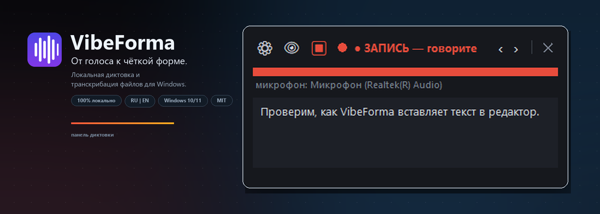

<p align="center">
  <a href="https://vibeforma.pro/ru/">
    
  </a>
</p>

<h1 align="center">VibeForma</h1>

<p align="center">
  <strong>От голоса к чёткой форме.</strong><br>
  Локальная голосовая диктовка и транскрибация файлов для Windows — без облака, аккаунта и телеметрии.
</p>

<p align="center">
  <a href="https://github.com/FormaMindPro/vibeforma/actions/workflows/ci.yml"></a>
  <a href="https://github.com/FormaMindPro/vibeforma/releases"></a>
  <a href="LICENSE"></a>
  
  
  
  
  <a href="https://vibeforma.pro/ru/"></a>
</p>

<p align="center">
  <a href="README.md">English</a> ·
  <strong>Русский</strong> ·
  <a href="https://vibeforma.pro/ru/">Сайт</a> ·
  <a href="https://vibeforma.pro/ru/introduction/">Документация</a> ·
  <a href="https://vibeforma.pro/ru/comparison/">Сравнение</a> ·
  <a href="https://github.com/FormaMindPro/vibeforma/releases">Релизы</a> ·
  <a href="https://github.com/FormaMindPro/vibeforma/issues">Ошибки</a>
</p>

> **VibeForma 0.5.6** убирает выдуманное «Продолжение следует» в конце фразы: финальный проход сверяет хвостовую стоп-фразу со звуком самого захода и срезает её, только если она не была сказана, — сказанная вслух фраза остаётся. 0.5.5 принесла проверку обновлений моделей Whisper по согласию. Подробности — [«Что нового в 0.5.6»](#что-нового-в-056).

## Что такое VibeForma

VibeForma — локальное приложение голосовой диктовки и транскрибации файлов для Windows. Поставьте курсор туда, где должен появиться текст, нажмите `Ctrl+Alt+Space`, говорите — и распознанный текст появляется в том окне, где вы работали: редактор, браузер, чат, IDE, терминал.

Распознавание идёт на вашей машине через [faster-whisper](https://github.com/SYSTRAN/faster-whisper). Модель понимает около 99 языков; интерфейс и закреплённый язык распознавания поставляются на английском и русском. Ничего не уходит в облачный аккаунт. Сеть нужна один раз — чтобы скачать модель, — а потом только для необязательных проверок обновлений.

Тот же движок транскрибирует аудио и видео, в том числе целые папки, в TXT, JSON, SRT или VTT с таймкодами. Диктовка и файловые задания делят одну локальную очередь, один язык и одну модель приватности.

**Коротко**

| | |
| --- | --- |
| Платформа | Windows 10/11 x64, ARM64 |
| Распознавание | локальный faster-whisper; CUDA float16 или CPU int8 |
| Модели | large-v3, large-v3-turbo, medium, small — переключение без перезапуска; сохранённые локальные CT2-папки с добавлением, выбором, удалением записи и возвратом к встроенной |
| Диктовка | глобальный хоткей, режим переключателя или удержания, автостоп по VAD, непрерывный режим без лимита 120 с, `Esc` — отмена; пресеты качества «Обычный» / «Точный» / «Быстрый» |
| Системный звук | живые субтитры звука вывода в панели и запись захода в WAV с TXT и SRT рядом; ничего не вставляется |
| Языки | точное закрепление, 26 кодов в меню, ~99 языков модели, пресет пунктуации для каждого кода меню; интерфейс EN/RU |
| Вход | mp4, mkv, mov, webm, mp3, wav, m4a, m4b, ogg, flac |
| Выход | TXT, JSON, SRT, VTT с резкой по предложениям; пакеты папок с зеркальным деревом |
| Интеграции | CLI, MCP-сервер для ИИ-агентов, локальный HTTP API на `127.0.0.1`, OpenAI-совместимый endpoint, job API, stdin-хук |
| Свой архив | словарь, сниппеты, профили приложений, история (по желанию; звук — отдельным включением, перераспознавание одной записи), статистика — файлы рядом с `config.json` |
| Цена | бесплатно, открытый код, MIT |

## Что нового в 0.5.6

- **Без выдуманного окончания.** Whisper иногда дописывает после последнего слова служебную строку, которой не было в записи, — заметнее всего «Продолжение следует»; один стоп-лист не мог убрать её, не рискуя срезать сказанную фразу. Теперь финальный проход диктовки сверяет хвостовую стоп-фразу со звуком самого захода через VAD: если слова фразы пересекаются с найденной речью меньше чем на 0,15 с, фраза и всё после её первого слова срезаются — в тексте, списке слов и субтитрах. Сказанная вслух фраза остаётся; заход без отметок слов или со сбоем VAD не меняется. Срез пишется в журнал с фразой и отрезком времени, без текста диктовки. Живые частичные подсказки и файловая транскрибация не тронуты.

## Что нового в 0.5.5

- **Обновления моделей Whisper — по согласию.** Фоновая проверка раз в 24 часа (настраивается, можно выключить) сверяет скачанные модели с Hugging Face и при новой ревизии предлагает её на вкладке **«Модель и язык»**: кнопки **«Обновить»** и **«Не сейчас»**, одно уведомление в трее, ручная проверка кнопкой; отклонённая ревизия не предлагается снова даже после перезапуска. Обновление идёт только по вашему клику, по одной модели за раз и только при свободной службе — посреди записи понятный отказ «дождитесь окончания». Новая ревизия скачивается во временную папку, проверяется тем же гейтом, которым приложение проверяет любую модель, и занимает место старой; **прежняя ревизия сохраняется на диске** как `previous-<модель>-<ревизия>`, поэтому обновление, которое загрузилось, но стало хуже, откатывается без повторной загрузки (удалите сохранённую папку, чтобы вернуть место). Любой сбой возвращает прежнюю папку, конфиг и рабочую модель. Без сети всё продолжает работать — проверка никогда не ломает диктовку офлайн.

## Что нового в 0.5.4

- **«Открыть» работает до первой записи.** Кнопка «Открыть» рядом с папкой записей на вкладке «Запись» до первой записи системного звука выдавала «Не удалось открыть папку записей»: папка создаётся первой записью, а не при установке, и кнопка передавала Проводнику путь, которого ещё не существовало. Теперь кнопка сначала создаёт папку тем же правилом, которым пользуется запись, — она работает на чистой установке сразу; сообщение появляется, только когда папку действительно невозможно создать (занятый путь, отказ в доступе).

## Быстрый старт

Windows 10/11 x64, Python 3.10+ в `PATH`. Одна команда в PowerShell:

```powershell
irm https://raw.githubusercontent.com/FormaMindPro/vibeforma/main/install.ps1 | iex
```

Она находит Python, скачивает последний релиз, ставит всё в `%LOCALAPPDATA%\VibeForma` (своё окружение `.venv`, зависимости, модель распознавания, ярлыки и запись в «Параметры → Приложения») и запускает сервис. Нажмите `Ctrl+Alt+Space` в любом приложении и говорите.

Установщик спросит папку установки: Enter — `%LOCALAPPDATA%\VibeForma`, либо укажите другой каталог, например `D:\VibeForma`.

Запустить позже: **«Пуск» → VibeForma**, ярлык на рабочем столе или `%LOCALAPPDATA%\VibeForma\run.cmd`. Значок сервиса живёт в трее.

Параметры передаются после блока скрипта:

```powershell
iex "& { $(irm https://raw.githubusercontent.com/FormaMindPro/vibeforma/main/install.ps1) } -Model large-v3 -NoRun"
```

- `-Model <имя>` — поставить эту модель вместо диалога выбора
- `-Target <папка>` — папка установки без вопроса (по умолчанию `%LOCALAPPDATA%\VibeForma`)
- `-Cpu` — только CPU (int8), даже если есть CUDA
- `-DryRun` — показать план и ничего не менять
- `-NoRun` — не запускать сервис в конце

Из `cmd.exe`: `powershell -c "irm https://raw.githubusercontent.com/FormaMindPro/vibeforma/main/install.ps1 | iex"`

Bootstrap ставит только выпущенные сборки: если zip релиза скачать не удалось, он останавливается с причиной и не подменяет релиз веткой main. Остальные способы установки (релизный zip, git), все флаги и удаление — раздел [«Установка»](#установка).

## Возможности

| Область | Что делает VibeForma |
| --- | --- |
| Диктовка | `Ctrl+Alt+Space` (меняется) начинает заход; фраза закрывается по паузе тишины, повторным нажатием или отпусканием в режиме удержания. Непрерывный режим включён по умолчанию: длинный заход режется по паузам и на 30 с с переносом хвоста, и лимит 120 с больше не рвёт речь; текст вставляется один раз. `Esc` отменяет. |
| Вставка | Текст идёт в окно, которое было активно при нажатии хоткея. Если окно сменилось, VibeForma предлагает «вставить здесь / скопировать / отмена», а не вставляет в чужое окно. Вставка ждёт отпускания хоткея, поэтому удерживаемая комбинация не превращает Shift+Insert в мёртвое сочетание. |
| Бережный буфер | Вставка Shift+Insert не зависит от раскладки; прежний буфер возвращается через 1 с, если вы не скопировали что-то новое; продиктованный текст исключён из истории буфера Windows и облачной синхронизации. |
| Панель мониторинга | Уровень микрофона, секундомер записи (остаток или прошедшее время), индикатор VAD, текст почти в реальном времени, режим приватности, кнопка микрофона, стрелки истории и действия с черновиком (править, копировать, вставить, отменить). Сомнительная фраза остаётся черновиком с подсветкой сомнительных слов и предлагает **«Распознать точнее»** / **«Вернуть прежний»**; подсказка о языке появляется, когда ведёт другой язык; системный заход показывает последние фразы как живые субтитры и пишет заход в WAV с TXT и SRT рядом. |
| Системный звук | Запись устройства вывода по умолчанию через WASAPI loopback (Bluetooth, USB, HDMI). Заход идёт без автостопа по тишине и без лимита 120 с, показывает последние фразы как живые субтитры и пишется в WAV 16 бит / 16 кГц моно, а по остановке рядом ставятся TXT и SRT (по умолчанию `Documents\VibeForma\Recordings`, подпапка даты); путь виден в панели, трее и HUD. В активное окно, черновик и историю диктовки ничего не попадает; тот же хоткей останавливает запись, буфер 30 с держит память, недоступный loopback или папка дают понятную ошибку. Пределы: дольше 6 ч или больше 4 ГБ — WAV остаётся, расшифровки нет; `Esc` и выход закрывают WAV, не ставя её в очередь. |
| Модели | large-v3, large-v3-turbo, medium и small; диалог выбора при установке; переключение в настройках или трее без перезапуска; неудачная загрузка откатывается; `model` принимает и папку с конвертированной CT2-моделью — она грузится офлайн и проверяется до загрузки; вкладка «Модель и язык» хранит список локальных папок с добавлением, выбором, удалением записи и возвратом к встроенной, а папка пользователя никогда не удаляется при переключении. |
| Качество распознавания | «Обычный (рекомендуется)» — beam 5 с резервом 0.0 → 0.2; «Точный» — beam 10 при температуре 0; «Быстрый» — beam 1 при температуре 0. Выбор `quality_preset` применяется к следующему финальному проходу диктовки без перезапуска; файловая транскрибация и живые субтитры сохраняют свои настройки. |
| Языки | Точное закрепление — без автоугадывания; 26 кодов в меню, около 99 языков в модели; каждый язык написан на самом себе; пресет пунктуации есть у каждого языка меню, а подсказка «похоже на X, выбран Y» появляется, когда ведёт другой язык. |
| Словарь | Термины уходят в `hotwords` на каждом 30-секундном окне, в целевой форме и по частотности правок; замены применяются к тексту (регистр не важен, длинный термин побеждает); импорт/экспорт JSON и предпросмотр; **профили приложений** дают одному окну свои термины поверх глобальных. |
| Сниппеты | Произнесённые триггеры разворачиваются в заготовленный текст; хранятся в JSON; профиль приложения может нести свои сниппеты. |
| История (по желанию) | Последние 100 диктовок в `history.jsonl`; таблица «Когда / Знаков / Приложение / Текст», поиск и фильтры, удаление нескольких строк, отмена последней вставки, возврат буфера. `history_audio` дополнительно хранит WAV каждого захода под потолком 200 МиБ и удаляет его вместе с записью; трей перераспознаёт последнюю запись другим промптом и моделью, а запись с сохранённым WAV получает в окне истории **«Распознать точнее»**. Выключение истории удаляет файл и сохранённый звук. |
| Статистика | Счётчики диктовок и знаков; только числа, без текста. |
| Транскрибация файлов | Аудио и видео (mp4, mkv, mov, webm, mp3, wav, m4a и другие) через тот же движок; декодирование PyAV, без внешнего ffmpeg; TXT, JSON, SRT, VTT с таймкодами; SRT и VTT режутся по предложениям из таймкодов слов; выдуманные фразы на тишине и музыке отсекаются; файл с таймкодами слов больше не падает на `IndexError` библиотеки. |
| Пакеты папок | Целая папка, по желанию рекурсивно; зеркальное дерево результатов; существующие файлы пропускаются; сбой одного файла не останавливает пакет; отмена; полоса прогресса. |
| Длинные файлы | Файлы от 60 с идут через `BatchedInferencePipeline`; каждый сегмент пакетного прохода проверяется теми же порогами и перераспознаётся последовательно при провале; подсказка несёт хвост предыдущего блока; лимиты 4 ГБ / 6 ч; очередь заданий, где диктовка всегда важнее файла. |
| Локальный HTTP API | По умолчанию выключен; только `127.0.0.1`; токен; `/health`, `/transcribe`, OpenAI-совместимый `/v1/audio/transcriptions` и очередь `/jobs`; `/jobs`, `/v1` и CLI принимают `prompt`, `word_timestamps` и `clip_timestamps`; `verbose_json` несёт уверенность сегментов и `words[]` верхнего уровня; обнаружение через `location.json`. |
| CLI | `--toggle`, `--cancel`, `--status`, `--transcribe`, `--transcribe-folder`, `--cancel-batch`, `--prompt`, `--words`, `--clip`, `--doctor`, `--selftest`, `--help`; говорит с запущенным сервисом по именованному каналу. |
| Хук | `hook_command` получает распознанный текст на stdin, без shell, с таймаутом 1–30 с; сбой не влияет на вставку. |
| Настройки | Вкладки «Запись», «Горячие клавиши», «Модель и язык», «Словарь», «Сниппеты», «История», «Статистика», «Вид», «Система»; на «Записи» — источник звука и **качество распознавания**, на «Модели и языке» — список локальных папок, на вкладке «Словарь» — **профили приложений**, на вкладке «Система» — **«ИИ и автоматизация»**. Изменения применяются на живом сервисе. `text_cleanup`, `dictation_context`, `history_audio`, `continuous`, `system_recordings_dir` и `actions` пока живут в `config.json`. |
| Трей | Пауза, устройство ввода, модель, язык распознавания, история, перераспознать последнюю диктовку, отмена последней вставки, диагностика, папка логов; автозапуск с Windows. |
| Приватность | Локальное распознавание, без аккаунтов и телеметрии; логи без текста диктовки и заголовков окон; сеть — только для загрузки модели и необязательных проверок обновлений; звук истории включается по желанию и остаётся в папке данных. |
| Обновления | Фоновая проверка раз в 2 ч (настраивается, можно выключить); текущая версия и кнопка **«Проверить обновления»** в шапке настроек с 0.4.3; новый релиз предлагается, а не ставится молча; выжимка изменений в уведомлении; архив сверяется с `SHA256SUMS` до распаковки; обновление ждёт, пока идёт запись или файловое задание, и само повторяется в режиме `auto`; один клик сохраняет данные. |
| Установка и удаление | Одна команда PowerShell; установка для пользователя в `%LOCALAPPDATA%\VibeForma`; запись в «Параметры → Приложения»; `uninstall.cmd --remove-data` убирает всё, что создал установщик и приложение, и оставляет папку готовой к чистой установке; `--keep-data` сохраняет модели, настройки, логи, историю, статистику и правки; ваши собственные файлы остаются и называются. |
| Интерфейс | Английский и русский из коробки; положите JSON-файл в `app/locales/`, чтобы добавить другой язык. |

## Почему я это сделал

Я сделал VibeForma потому, что мне нужно было распознавать собственный голос — каждый день, посреди работы, не выходя из потока.

Приложения, которые я пробовал, либо вообще не умели диктовку, либо делали её по-своему: другой хоткей, другая модель, другое представление о том, что происходит с текстом после того, как вы сказали. Ни одно не давало того, что мне действительно было нужно: быстрого и предсказуемого инструмента, который хранит мой собственный архив и не зависит от внешнего сервиса, который может упасть, изменить условия или тихо перестать поддерживать мой язык.

Русский был решающим случаем. Многие продукты относятся к нему как к языку второго сорта — если вообще его поддерживают. Я хотел, чтобы русский был первым: закреплённый язык распознавания, русский интерфейс, русская документация и модель, которая не угадывает.

И я хотел, чтобы тот же инструмент превращал видео и аудио в текст — локально, на моей машине, — потому что именно эта работа накапливается: интервью, лекции, звонки, фильмы, заметки себе. Файловый режим, пакеты папок, CLI и локальный API выросли из этой потребности.

Поэтому VibeForma сознательно local-first и Windows-first. Она небольшая, честно говорит о своих ограничениях и принадлежит мне — а значит, и вам, по лицензии MIT. Если вам нужно, чтобы голос становился текстом без разрешения облака, — это инструмент, который я сделал для этого.

## Сравнение с аналогами

Это не рейтинг и не реклама. Снимок на **23 ноября 2026 года**; факты взяты из репозиториев и документации проектов. Полная страница с десятью продуктами и источниками — [vibeforma.pro/ru/comparison](https://vibeforma.pro/ru/comparison/).

| Продукт | Тип | Платформы | Локальное распознавание | Диктовка | Транскрибация файлов | Русский интерфейс / документация | Цена / исходники |
| --- | --- | --- | --- | --- | --- | --- | --- |
| **VibeForma** | локальная диктовка и транскрибация файлов | Windows 10/11 | Да, faster-whisper | Да | Да — файлы и пакеты папок | Да / Да | Бесплатно, MIT |
| Handy | локальная диктовка | Windows, macOS, Linux | Да, Whisper | Да | н/д | н/д / н/д | Бесплатно, открытый код |
| Buzz | локальная транскрибация | Windows, macOS, Linux | Да, Whisper | Нет | Да | н/д / н/д | Бесплатно, открытый код |
| Whispering | локальная или подключённая транскрибация | Windows, macOS, Linux | Да или провайдер | Да | Да | н/д / н/д | Бесплатно, открытый код |
| Superwhisper | коммерческая диктовка | macOS, Windows, iOS, Android | Локально и облако | Да | Да | н/д / н/д | Подписка, закрытый код |
| Wispr Flow | коммерческая диктовка | macOS, Windows, iOS, Android | н/д | Да | н/д | н/д / н/д | Подписка, закрытый код |
| Descript | транскрибация и редактирование | macOS, Windows | н/д | Нет | Да | н/д / н/д | Подписка, закрытый код |

Обозначение: **н/д** — публичного подтверждения в перечисленных источниках на дату снимка не найдено; это не доказывает отсутствие функции. Цены и планы меняются — проверяйте страницу производителя.

### Где VibeForma сильнее

- **Windows-first.** Вставка в окно, активное при нажатии хоткея, возврат буфера, исключение из истории буфера Windows и облачной синхронизации, DPI-aware окна, иконка в трее и запись в «Параметры → Приложения». Системный звук приходит через свой WASAPI loopback, читается как живые субтитры и пишется в WAV с TXT и SRT рядом.
- **Русский как первый язык.** Закреплённый язык распознавания, названия языков на самих языках, пресет пунктуации для всех 26 языков меню, подсказка о языке, когда ведёт другой, русский интерфейс и русская документация — не переведённая страница помощи, приделанная к английскому продукту.
- **Локальный API, CLI, хук и MCP-сервер без облачного аккаунта.** API слушает только `127.0.0.1` и требует токен; `location.json` публикует фактический порт; CLI говорит с запущенным сервисом по именованному каналу; `hook_command` передаёт текст на stdin без shell; MCP-сервер отдаёт агенту тот же транскрибатор по stdio, не открывая порт. Агент получает контракт движка — промпт, таймкоды слов, диапазон и уверенность сегментов со словами и вероятностями.
- **Свой архив.** Словарь, сниппеты, профили приложений, история и статистика живут в файлах рядом с `config.json`. История включается по желанию и хранит текст; с `history_audio` она хранит и WAV захода, трей умеет перераспознать последнюю запись, а окно истории — одну сохранённую; статистика хранит только числа. Ничего не загружается.
- **Локальные файлы и папки.** Аудио и видео транскрибируются тем же движком, с таймкодами и четырьмя форматами вывода; плашки SRT и VTT идут по предложениям, блоки длинного файла несут контекст, сегмент пакетного прохода с провалом перераспознаётся, выдуманные фразы отсекаются, а `model` может указывать на папку с конвертированной CT2-моделью. Без загрузки и без очереди в чужом облаке.
- **Точное закрепление языка.** Модель распознаёт ровно тот язык, который вы указали. Для русского и смешанной лексики это предсказуемее, чем угадывание на каждой фразе; подсказка называет услышанный язык, не меняя настройку.
- **Без аккаунта и телеметрии.** Нет входа и нет сервера, который получает аудио. Сеть используется для загрузки модели и необязательных проверок обновлений, и оба случая названы явно.
- **Небольшая и честная.** VibeForma не притворяется платформой для встреч. Её ограничения описаны отдельной страницей и в разделе [«Где VibeForma слабее»](#где-vibeforma-слабее).

### Где VibeForma слабее

- **Только Windows.** Нет версий для macOS, Linux, iOS и Android.
- **Один файл за раз.** Файлы и папки транскрибируются последовательно. Buzz, Whispering, Superwhisper и Descript — инструменты, для которых транскрибация первична, и для больших пакетов они могут подойти лучше.
- **Длинный заход может потерять буферный звук.** Если распознавание отстаёт и не принимает кусок (например, на очень слабой машине при долгой непрерывной диктовке), движок на 240 с отбрасывает накопленный звук и пишет предупреждение в лог, вместо того чтобы растить память без предела; этот кусок не транскрибируется.
- **У записей системного звука есть пределы.** Заход дольше 6 часов или больше 4 ГБ сохраняет WAV, но не получает TXT и SRT, а `Esc` или выход закрывают WAV, не ставя расшифровку в очередь. На музыке живой фильтр убирает только короткие стоп-фразы и петли повторов, поэтому остальной выдуманный текст может дойти до панели.
- **Пунктуация — у модели Whisper.** Отдельной модели пунктуации нет: Silero text enhancement не включён, потому что его лицензия некоммерческая, зависимость и модель добавляют около 219 МБ, а качество на русском не подтверждено (ADR 0001). Числа берёт чистка текста по желанию, слова-паразиты и заглавные — её правила.
- **Два языка интерфейса.** Английский и русский. Коммерческие справочные центры покрывают гораздо больше.
- **Нет встреч, резюме, команд и биллинга.** Superwhisper, Wispr Flow и Descript закрывают сценарии, которых у VibeForma нет.
- **Нет облачных моделей.** Всё идёт на локальной машине, поэтому очень слабый CPU или GPU означает медленное распознавание; облачные продукты снимают эту нагрузку.
- **Нет мобильной версии.** Диктовка происходит за рабочим столом Windows.
- **Меньше экосистема и короче история.** Проект молодой; у коммерческих продуктов годы релизов и большие команды поддержки.
- **Неподписанный установщик.** Windows SmartScreen может предупредить; сертификата подписи кода пока нет.

### Как выбрать

- **Вы работаете на Windows и хотите локальную диктовку везде** → VibeForma. Начните с [быстрого старта](#быстрый-старт).
- **Нужны macOS или Linux** → Handy, VoiceInk (macOS) или Whispering.
- **Нужно транскрибировать записанные файлы** → VibeForma для локальных файлов и пакетов папок; Buzz или Whispering для больших пакетов.
- **Нужны встречи, резюме и мобильные приложения** → Superwhisper, Wispr Flow или Descript.
- **Вы строите интеграцию редактора или агента** → [MCP-сервер](#подключение-ии-агента-mcp), [локальный API](#локальный-http-api-по-умолчанию-выключен) и [командная строка](#командная-строка-и-внешняя-команда) VibeForma, либо коммерческий API-сервис.
- **Нужен движок, а не приложение** → whisper.cpp или faster-whisper напрямую.

## Обновление

Сервис сам проверяет релизы на GitHub в фоне (по умолчанию раз в 2 ч; переключатель и интервал — в настройках). В шапке окна настроек также видны текущая версия и кнопка **«Проверить обновления»** на каждой странице (0.4.3). Когда найден новый релиз, на панели мониторинга и в трее появляется синяя кнопка **«Обновить»**. Один клик запускает тот же установщик, что и быстрый старт: модель, словарь, история и `config.json` сохраняются, сервис перезапускается. Архив сверяется с `SHA256SUMS` до распаковки, а обновление ждёт, пока идёт запись или файловое задание; в режиме `auto` оно само повторяется, когда работа завершится (0.4.4).

Вручную: закройте VibeForma из трея и выполните команду быстрого старта ещё раз. Если программа стоит не в папке по умолчанию, добавьте `-Target`:

```powershell
iex "& { $(irm https://raw.githubusercontent.com/FormaMindPro/vibeforma/main/install.ps1) } -Target "D:\VibeForma"
```

Обновление — тот же релизный zip с GitHub, что и первая установка, вместе с `SHA256SUMS` для сверки; больше ничего не скачивается и дополнительных шагов не нужно.

## Удаление

VibeForma видна в **«Параметры → Приложения»** (для текущего пользователя, без прав администратора). Удалить можно оттуда или запуском `uninstall.cmd` в папке сервиса. Удалятор убирает ярлыки, запись автозапуска, запись в «Параметрах → Приложения» и всё, что создали установщик и приложение — пакет `vibeforma\`, `mcp.cmd`, файлы требований, `status.json` и `location.json`. С `--remove-data` он убирает ещё модели, `config.json` (с вашими `hotwords`), логи, историю и её звук, статистику и правки словаря, затем удаляет опустевшую папку, и установщик принимает тот же путь как чистую установку. `--keep-data` сохраняет данные и пропускает вопрос. Файлы, которые вы положили в папку сами, остаются и называются на экране; верхнеуровневый `.py` считается файлом приложения. Удаление не идёт по символической ссылке или junction за пределы папки установки.

## Установка

Windows 10/11, Python 3.10+ (лучше 3.12+). С видеокартой NVIDIA распознавание быстрое (CUDA float16); без неё установщик переключится на CPU (int8), сам предложит модель `small` и поставит только базовые зависимости.

**Одна команда (PowerShell, Windows 10+):**

```powershell
irm https://raw.githubusercontent.com/FormaMindPro/vibeforma/main/install.ps1 | iex
```

Бутстрап скачает последний релиз вместе с `SHA256SUMS`, сверит хеш, распакует архив и запустит установщик — всё остальное (.venv, зависимости, модель, ярлыки) произойдёт само. Ставится только релизная сборка: если релизного zip нет, бутстрап останавливается и объясняет причину, а не скачивает ветку main. Без `-Model` модель выбирается в небольшом диалоге при установке. С параметрами:

```powershell
iex "& { $(irm https://raw.githubusercontent.com/FormaMindPro/vibeforma/main/install.ps1) } -Model large-v3 -NoRun"
```

(из `cmd.exe`: `powershell -c "irm https://raw.githubusercontent.com/FormaMindPro/vibeforma/main/install.ps1 | iex"`)

**Вариант A — релизный zip:** скачайте `VibeForma-<версия>.zip` в [Releases](../../releases), распакуйте, запустите `install.cmd`.

**Вариант B — git:**

```bat
git clone https://github.com/FormaMindPro/vibeforma.git
cd vibeforma
install.cmd
```

Установщик: копирует `app/` в `%LOCALAPPDATA%\VibeForma` → создаёт `.venv` → ставит зависимости → скачивает модель (единственный сетевой шаг; пропускается, если модель уже в общем кэше Hugging Face) → пишет `config.json` → создаёт ярлыки (рабочий стол, меню «Пуск» и автозапуск, фирменная иконка) → записывает продукт в «Параметры → Приложения» → запускает сервис.

Базовые зависимости ставятся из `app/requirements.txt`; колёса CUDA (`nvidia-cublas-cu12`, `nvidia-cudnn-cu12`) — из `app/requirements-cuda.txt` только при найденной CUDA, на CPU они не скачиваются. На CPU диалог предлагает модель `small`, а в `config.json` пишутся `device: "cpu"`, `compute_type: "int8"`; существующий конфиг с `cuda` на машине без CUDA исправляется (на интерактивном запуске — с вопросом в консоли, без него — молча, с записью в журнал). Язык распознавания берётся из локали Windows (`ru` на русской Windows), `en` — если подходящего кода нет; поменять можно в диалоге или флагом `--language`.

Если найдена старая папка `%LOCALAPPDATA%\WhisperDictation`, её `config.json` (вместе с `hotwords`) и скачанные `models` копируются в новую установку, а старые ярлыки с рабочего стола, из автозапуска и меню «Пуск» удаляются — чтобы не автозапускались две копии. Сама старая папка копируется, но не удаляется: уберите её после того, как новая версия заработает.

До записи установщик проверяет Windows 10 сборки 1809+, x64/ARM64, Python 3.10–3.14, свободное место (модель + 4 ГБ) и целевую папку — пустую, существующую установку VibeForma или папку, помеченную прошлым запуском. Системные каталоги, Program Files, корень диска и корень профиля отклоняются. Первый сбойный шаг останавливает цепочку: ни ярлыков, ни конфига, ни запуска. Сбой первой установки удаляет созданную папку; существующая установка восстанавливается из бэкапа. `install.log` (по умолчанию `%LOCALAPPDATA%\VibeForma\logs`, изменить можно через `--log`) хранит шаги, команды и хвост ошибки, а консоль печатает путь к нему. Повторный запуск продолжает с места сбоя — готовые `.venv`, модель и `config.json` переиспользуются.

Флаги установщика:

| Флаг | Значение |
| --- | --- |
| `--model <имя>` | модель для установки; без флага откроется диалог выбора (на существующей установке останется модель из конфига) |
| `--language <код>` | язык распознавания; по умолчанию — локаль Windows, `en`, если подходящего кода нет |
| `--target <папка>` | каталог сервиса (по умолчанию `%LOCALAPPDATA%\VibeForma`) |
| `--dry-run` | показать план, ничего не выполняя |
| `--cpu` | принудительно CPU (int8), даже если есть CUDA |
| `--no-run` | не запускать сервис в конце |
| `--log <файл>` | путь журнала установки (по умолчанию `%LOCALAPPDATA%\VibeForma\logs\install.log`) |

## Первый запуск

При первом запуске открывается помощник из трёх шагов. Шаг 1 — язык интерфейса и распознавания. Шаг 2 — микрофон: уровень движется, когда он слышит вас, а «Проверить микрофон» делает короткую запись и показывает распознанный текст — никуда он не вставляется. Шаг 3 — горячая клавиша: она записывается нажатием; одни модификаторы не принимаются, а комбинация, занятая Windows, — только предупреждение. «Пропустить» записывает безопасные значения по умолчанию. Помощник открывается повторно из трея («Помощник настройки…») или из настроек, вкладка «Система»; флаг `onboarding_done` в `config.json` помнит, что он уже проходил.

## Модели

| Модель | Имя в меню | Размер | Скорость | Качество |
| --- | --- | --- | --- | --- |
| large-v3 | «large-v3» | 3,1 ГБ | базовая | лучшая пунктуация |
| large-v3-turbo | «large-v3-turbo» | 1,6 ГБ | быстро | близко к large-v3 |
| medium | «medium» | 1,5 ГБ | ×4 к large-v3 | среднее |
| small | «small» | 0,5 ГБ | ×10 к large-v3 | ниже |

Модель выбирается при установке (диалог показывает размер и описание); потом переключается в настройках (вкладка *«Модель и язык»*) или в трее. Переключение сначала скачивает новую модель, перезагружает сервис без перезапуска и затем — по галочке — оставляет прежнюю модель на диске для быстрого возврата или удаляет её (модель в общем кэше Hugging Face не трогается; неудачная загрузка не трогает прежнюю модель). Модели живут в `%LOCALAPPDATA%\VibeForma\models\<имя>` или в общем кэше Hugging Face; сервис грузит их offline-first и выходит в сеть, только когда модели нет нигде на диске. `model` принимает и путь к папке с конвертированной CT2-моделью: папка грузится с `local_files_only=True` и проверяется на `model.bin` с заголовком CT2, `config.json`, `tokenizer.json` и словарь; битая папка останавливает загрузку понятной ошибкой, а не скачиванием каталожной модели. Для офлайн-установки положите папку модели в `models\<имя>` (или в общий кэш Hugging Face) заранее — тогда сеть не нужна ни установщику, ни сервису.

**Локальные папки моделей.** Вкладка *«Модель и язык»* держит ещё и короткий список CT2-папок. **«Добавить папку»** проверяет `model.bin` и отказывает папке без него; **«Использовать»** переключает через тот же диалог прогресса и оставляет текущую модель, если загрузка не удалась; **«Убрать из списка»** удаляет только запись, никогда файлы; **«Вернуть встроенную»** снова выбирает каталожную модель. Список — `model_folders` в `config.json` как имя + абсолютный путь, до 20; ручной путь в `model` по-прежнему работает. Переключение с папки никогда её не удаляет, даже при выключенном «оставить прежнюю модель»: удаляются только скачанные модели внутри `models\`.

Замер на тестовой фразе 12,5 с (CUDA float16, лучшее из 3):

| Модель | Распознавание | Замечание |
| --- | --- | --- |
| large-v3 | 1,53 с | пунктуация богаче |
| large-v3-turbo | 0,64 с (~2,4× быстрее) | все слова верны, пунктуация беднее |

На коротких фразах реальный выигрыш turbo ниже «заводских» 4–8× (доля нескалируемых этапов выше); на длинных аудио разрыв растёт.

## Языки

- **Распознавание**: точное закрепление — модель распознаёт ровно выбранный язык (по умолчанию `en`); переключение в трее или в настройках. Без автоопределения: что указали, то и распознаётся. Пресет пунктуации есть у каждого из 26 языков меню, каждый написан своей письменностью; личные термины — в `config.json → "hotwords"`, и они доходят до каждого 30-секундного окна. Когда закреплённый язык выглядит маловероятным, а ведёт другой, панель говорит «похоже на X, выбран Y», не меняя настройку.
- **Названия в меню**: каждый язык написан на самом себе — English, Русский, Українська, Deutsch, 日本語…
- **Интерфейс**: английский и русский лежат в `app/locales/*.json`. Чтобы добавить свой — скопируйте `en.json`, переведите значения, сохраните как `app/locales/<код>.json`; язык сам появится в настройках.

## Использование

1. Запустите сервис (ярлык на рабочем столе или автозапуск) — появится иконка в трее, откроется панель мониторинга.
2. Проверьте, что панель видит микрофон (полоса уровня дёргается при речи; иначе выберите устройство в трее).
3. `Ctrl+Alt+Space` → говорите → пауза → текст вставится в поле, которое было активно при нажатии хоткея.
4. `✕` прячет панель (иконка в трее остаётся), `⚙` открывает настройки.

## Приватность

- Запись и распознавание — локальные процессы. Сетевые контакты: первая загрузка модели при установке; и, если автообновление включено (по умолчанию), небольшой запрос к `api.github.com` раз в 2 ч — интервал настраивается, проверку можно выключить в настройках. Zip релиза скачивается только когда есть новая версия. Больше ничего не покидает машину.
- Логи лежат в локальной папке `logs\` с ротацией. Никакой телеметрии, аккаунтов, токенов. В логе нет ни текста диктовки, ни заголовков окон; `log_window_titles: true` в `config.json` добавляет заголовок окна-адресата, если он нужен для разбора.
- История включается по желанию и остаётся в папке данных; `history_audio` — второе «по желанию»: WAV захода хранится только там, под потолком 200 МиБ, и удаляется вместе с записью. Заходы системного звука пишутся в папку записей (или `system_recordings_dir`), никогда в историю; путь виден, пока идёт заход.
- На Windows 10+ продиктованный текст помечается как исключённый из истории буфера и облачной синхронизации. У панели мониторинга есть режим приватности (кнопка-глаз): текст скрыт, уровень микрофона виден, а строка статуса исчезает через 30 с.

## Что остаётся на диске

- `config.json` — ваши настройки и `hotwords` (термины, которые вы туда вписали);
- `models\` — скачанные модели Whisper;
- `logs\` — журнал сервиса (пять файлов по 1 МБ с ротацией), без текста диктовки и без заголовков окон по умолчанию;
- `history.jsonl` — только при включённой истории: последние 100 диктовок (текст, приложение, направление);
- `history_audio\` — только при включённых `history` и `history_audio`: WAV каждой диктовки под потолком 200 МиБ, удаляется вместе с записью, историей или опцией;
- `corrections.json` — выученные правки словаря;
- `Documents\VibeForma\Recordings\` (или `system_recordings_dir`) — заходы системного звука как WAV с TXT и SRT рядом; это ваши файлы, и лежат они вне папки установки;
- добавленные вами локальные папки моделей — там, куда вы их положили; переключение их не удаляет;
- `_http_in_*.wav` — только пока локальный HTTP API обрабатывает запрос; удаляется в любом случае, при успехе и при ошибке;
- `install.log` — журнал самого установщика;
- аудиозаписи микрофона не сохраняются, если вы не включили `history_audio`.

## Локальный HTTP API (по умолчанию выключен)

Включите его в настройках → **«Голос для внешних форм»** → **«Разрешить локальный API для форм»**. Ключ создаётся и сохраняется автоматически. API слушает только `127.0.0.1` и отвечает на `GET /health` и `POST /transcribe` с заголовком `X-VibeForma-Token: <секрет>`. `/health` возвращает `ok`, `app` (`vibeforma`), `api`, фактический `port`, `version`, `model`, `language` и `state`; `/transcribe` принимает `Content-Type: audio/wav`, тело WAV до 10 МБ, один запрос в секунду, только когда сервис свободен, и отвечает `{"text": "..."}`; загруженное аудио пишется во временный файл и удаляется в любом случае.

Сервис публикует `%LOCALAPPDATA%\VibeForma\location.json` с полями `schema` (2), `app`, `version`, `launcher`, `python`, `entry`, `install_dir`, `pipe`, `config`, `api` (`on`, `off` или `error`), `file_mode`, `formats`, `languages`, `max_file_mb`, `max_file_s` и фактическим `port`. Если настроенный порт (`8787` по умолчанию) занят, сервис занимает свободный loopback-порт и записывает его сюда, поэтому форма читает endpoint из этого файла, а не хардкодит порт. Секрета в файле нет: канал защищён своим DACL, а токен остаётся в `config.json`.

Файловый режим добавляет три вида маршрутов, все на `127.0.0.1` и все с тем же токеном:

- `GET /capabilities` — версия, модели, языки, форматы, лимиты, `file_mode`, `word_timestamps`, `dictation_priority`, `prompt`, `clip_timestamps`, канал и launcher;
- `POST /v1/audio/transcriptions` — OpenAI-совместимый multipart (`file`, `model`, `language`, `response_format`, `prompt`, `temperature`, `word_timestamps`, `clip_timestamps`); `response_format` — `json`, `text`, `srt`, `vtt` или `verbose_json`; `verbose_json` несёт `segments[].avg_logprob`, `no_speech_prob`, `compression_ratio` и `temperature`, а также `words[]` верхнего уровня с `probability`; синхронно до `file_max_sync_s` (900 с), более длинный файл получает `413` с указанием на `/jobs`;
- `POST /jobs`, `GET /jobs/<id>`, `DELETE /jobs/<id>` (отмена), `GET /jobs/<id>/result?format=srt|vtt|txt|json` — очередь длинных файлов; `POST /jobs` принимает `prompt`, `word_timestamps` и `clip_timestamps`, `/jobs/<id>` сообщает применённый контракт, ответ `202` с `Location: /jobs/<id>`, а до готовности результата `409`.

`/health` сохраняет старые поля и добавляет `file_mode`, `jobs_running`, `jobs_queued` и `dictation_priority`. Старый `/transcribe` не меняется: 10 МБ, один запрос в секунду, только в простое. Диктовка всегда важнее файлового задания: задание встаёт на паузу между сегментами и продолжается, когда сервис снова свободен.

## Подключение ИИ-агента (MCP)

Настройки → **«ИИ и автоматизация»** показывают локальный адрес, запускатель MCP и две кнопки копирования: ключ и готовый блок подключения, который можно отдать локальному ИИ-клиенту как есть. В блоке — адрес, токен, запускатель и инструменты.

MCP-клиент запускает `%LOCALAPPDATA%\VibeForma\mcp.cmd` как stdio-сервер:

```json
{
  "mcpServers": {
    "vibeforma": {
      "command": "C:\\Users\\<вы>\\AppData\\Local\\VibeForma\\mcp.cmd"
    }
  }
}
```

Сервер читает `location.json`, чтобы узнать фактический порт, и `config.json`, чтобы взять токен, — ничего не нужно вписывать вручную. Он даёт инструменты `vibeforma_capabilities`, `vibeforma_transcribe_file` и `vibeforma_job_status`; транскрибация ставит файл в очередь через `/jobs` и возвращает текст, когда задание готово, инструмент принимает `prompt`, `word_timestamps` и `clip_timestamps`, а статус задания сообщает применённый контракт. Локальный API должен быть включён: без него сервер отвечает понятным отказом. Сам сервис остаётся доступен только на loopback — MCP-сервер не открывает порт и никуда не отправляет токен.

## Транскрибация файлов

Аудио и видео идут через тот же движок, что и диктовка: mp4, mkv, mov, webm, mp3, wav, m4a. Декодирует PyAV (зависимость, которую уже приносит faster-whisper), поэтому внешний ffmpeg не нужен. Выход — текст с таймкодами в TXT, JSON, SRT или VTT. При включённых таймкодах слов плашки SRT и VTT режутся по предложениям: конец предложения или пауза 0,6 с и дольше закрывает плашку, более короткая пауза склеивает слова через швы окон движка и 600-секундных блоков; без таймкодов слов остаются сегменты движка. TXT и JSON сохраняют свой контракт.

Выдуманный текст отсекается: стоп-лист типовых ложных фраз ru и en, порог тишины 2,0 с при таймкодах слов и страж compression ratio отбрасывают сегмент на тишине или музыке, когда `no_speech_prob` не ниже 0,6; петля, которую движок всё ещё читает как речь, остаётся с пометкой. Файл с таймкодами слов больше не падает на ошибке `find_alignment` в faster-whisper: блок повторяется без таймкодов слов, повтор пишется в лог.

Длинные файловые задания (от 60 с) распознаются пакетно: несколько 30-секундных окон проходят через модель за один проход (`BatchedInferencePipeline`) на той же загруженной модели, с тем же языком, VAD, промптом и анти-галлюцинационными настройками. Короткие файлы и диктовка остаются на последовательном пути. Если пакетный путь недоступен или падает посреди файла, задание доходит последовательным путём без дублей. Каждый сегмент пакетного прохода проверяется теми же порогами, что и последовательный путь; проваливший сегмент перераспознаётся последовательно над своим куском блока, а факт пишется в лог; промпт несёт хвост предыдущего блока в 200 символов, чтобы имя держалось через шов. Ключи — `file_batched` (включён по умолчанию) и `file_batch_size` (8, в пределах 1-16); ускорение зависит от устройства, измеренное значение на эталонной машине — в `CHANGELOG.md`.

Из трея: **«Транскрибировать файл…»**, выберите файл, следите за прогрессом в панели, затем **«Открыть папку с результатом»**. Из командной строки (сервис должен быть запущен):

```
run.cmd --transcribe "D:\video\talk.mp4" --lang ru --format srt
run.cmd --transcribe "D:\video\talk.mp4" --format all --json
.venv\Scripts\python.exe main.py --transcribe talk.mp4 --out out\talk.srt
```

- `--lang` — язык распознавания (иначе из настроек, в крайнем случае английский);
- `--format` — `txt`, `json`, `srt`, `vtt` или `all` (по умолчанию `srt`);
- `--out` — файл или папка результата; без него результат ложится рядом с исходником с тем же именем;
- `--force` — разрешить перезапись существующего результата;
- `--prompt` — подсказка распознавания для этого файла (иначе настроенный пресет);
- `--words` — попросить таймкоды и вероятности слов, чтобы плашки SRT и VTT шли по предложениям;
- `--clip НАЧАЛО[,КОНЕЦ]` — распознать только этот диапазон в секундах; таймкоды остаются абсолютными, плохой диапазон даёт код 2;
- `--json` — печатает `{"ok": true, "job_id": ..., "out": [...], "segments": N, "duration_s": ...}`; прогресс уходит в stderr.

Коды возврата: `0` — успех, `1` — сервис не запущен или задание с ошибкой, `2` — неверные аргументы, `3` — отменено. Пока сервис загружает первую модель, CLI отвечает `VibeForma: the model is loading` и выходит с кодом 1; `VibeForma is not running` появляется, только если канал не слушает. Запрос идёт по именованному каналу текущего пользователя (`\\.\pipe\VibeForma-<user>`), поэтому CLI не открывает порт и не зависит от HTTP API.

Лимиты: `file_max_mb` (4096), `file_max_s` (6 часов), `job_keep_s` (24 часа хранения готового задания), `file_roots` (пусто — все локальные fixed/removable диски; сеть, UNC и device-пути запрещены). Исходный файл не копируется и не меняется. Сеть не используется ни для распознавания, ни для доставки. VibeForma отдаёт SRT/VTT; вшивание субтитров в видео и перевод — задача downstream-инструмента, не этого движка.

## Пакетная транскрибация папки

Целая папка проходит через тот же движок и ту же очередь, что и один файл, по одному файлу за раз. В трее выберите **«Транскрибировать папку…»** и укажите папку; из командной строки (сервис должен быть запущен):

```
run.cmd --transcribe-folder "D:\media" --format all --json
run.cmd --transcribe-folder "D:\media" --recursive --out D:\out
.venv\Scripts\python.exe main.py --transcribe-folder media --lang ru
```

- по умолчанию берётся только верхний уровень папки; `--recursive` добавляет подпапки;
- поддерживаемые файлы: mp4, mkv, mov, webm, mp3, wav, m4a, m4b, ogg, flac; остальные не попадают в пакет и не считаются ошибкой;
- без `--out` каждый результат ложится рядом со своим исходником; с `--out` дерево папки зеркалируется (`D:\media\sub\b.mkv` → `D:\out\sub\b.srt`);
- существующий выход пропускается, а не перезаписывается; `--force` перезаписывает его;
- два исходника с одинаковым именем (`a.mp4`, `a.mkv`) дают одну цель: второй файл записывается как `duplicate output target`, пакет продолжается;
- сбой одного файла записывается, остальные продолжаются; пакет завершается со счётчиками и ненулевым кодом, если что-то не удалось;
- диктовка важнее пакета: она начинается сразу, пакет встаёт на паузу между сегментами и возобновляется с того же файла;
- `--cancel-batch [<id>]` останавливает текущий файл и очередь;
- `--json` печатает одну сводку с `total/done/skipped/failed/cancelled/progress/files`; прогресс уходит в stderr.

HUD показывает нижнюю панель, пока идёт файл или пакет: движущуюся полосу, имя текущего файла, его процент и общий счётчик `Пакет: N/M — P%`. Состояния различимы (в очереди, транскрибация, пауза на диктовку, готово, ошибка), ошибка одного файла видна, пока пакет идёт, а итог скрывается через 8 секунд после завершения. Панель не забирает фокус и не трогает оверлей диктовки и горячую клавишу.

Коды возврата: `0` — все файлы готовы или пропущены, `1` — файл с ошибкой или сервис не запущен, `2` — неверные аргументы или папка отклонена, `3` — отменено, `4` — в папке нечего транскрибировать. Сеть, UNC и device-пути запрещены; drag&drop не является способом входа.

## Для агентов и других харнессов

Любой харнесс — Forma Mind, Claude Code, Cursor, Codex, скрипт PowerShell или процесс Python — использует один и тот же контракт уровня ОС; VibeForma не знает, кто именно его вызвал. Харнесс, говорящий на MCP, может пропустить весь контракт: см. [«Подключение ИИ-агента (MCP)»](#подключение-ии-агента-mcp).

1. Прочитайте `%LOCALAPPDATA%\VibeForma\location.json`: `launcher`, `python`, `entry` и `pipe`. Файла нет — сервис не запущен.
2. Вызовите launcher или python из `.venv` с entry-файлом и `--transcribe`:

```powershell
# PowerShell
& "$env:LOCALAPPDATA\VibeForma\run.cmd" --transcribe "D:\video\talk.mp4" --lang ru --format srt --json
# cmd.exe
"%LOCALAPPDATA%\VibeForma\run.cmd" --transcribe "D:\video\talk.mp4" --format srt
# Python
subprocess.run([launcher, "--transcribe", path, "--format", "srt", "--json"], check=True)
# Node.js
spawnSync(launcher, ["--transcribe", path, "--format", "srt", "--json"])
```

3. При включённом локальном API то же самое делают `POST /v1/audio/transcriptions` (короткие файлы) или `POST /jobs` (длинные); оба принимают `prompt`, `word_timestamps` и `clip_timestamps`, а `GET /capabilities` перечисляет форматы, лимиты, `prompt` и `clip_timestamps`.
4. `run.cmd --help` печатает контракт, поэтому харнессу не нужен исходник.

Python без shell всегда может использовать вторую форму: `.venv\Scripts\python.exe main.py --transcribe ...`.

## Командная строка и внешняя команда

Установленная копия — source-копия: `run.cmd`, `main.py` и `.venv` рядом, упакованного `VibeForma.exe` нет. Без аргументов `run.cmd` запускает панель через `pythonw.exe main.py`; с аргументами — `python.exe main.py` с этими аргументами, поэтому stdout, stderr и код возврата доходят до вызывающего. Обе формы равнозначны:

```
run.cmd --toggle
run.cmd --cancel
run.cmd --status
.venv\Scripts\python.exe main.py --status
```

`--toggle` начинает запись или останавливает идущую, `--cancel` отбрасывает текущую запись или черновик панели, `--status` печатает `status.json` работающего экземпляра (`state`, `version`, `pid`, `ts`) как JSON. `--prompt`, `--words` и `--clip` относятся к `--transcribe` и описаны в разделе «Транскрибация файлов». Флаги обращаются к уже запущенному экземпляру: если его нет или статус старше 60 с, код возврата 1; при успехе 0. `--help` печатает все команды.

Хук включается только явно и выключен, пока `"hook_command"` пуст. Задайте его в настройках → «Система» (или в `config.json` рядом с `"hook_timeout_s"`, по умолчанию 5): распознанный текст уходит на stdin команды в UTF-8. Команда запускается без shell, поэтому `&`, `|` и `>` в тексте — обычные символы; таймаут ограничен 1–30 с. Сбой или таймаут пишется в журнал только как статус — текст в журнал не попадает — и не влияет на вставку. Хук работает параллельно, после вставки текста или показа черновика панели.

## Структура репозитория

```
app/
  main.py              сервис: состояния, хоткей, потоки записи/распознавания, selftest
  audio.py             захват 16 кГц, уровень, Silero VAD, частичные транскрипции
  asr.py               faster-whisper: offline-first загрузка, транскрипция, смена модели
  transcript.py        файловый режим: сегменты и форматы TXT/JSON/SRT/VTT
  file_jobs.py         очередь файловых заданий: приоритет диктовки, пауза, отмена
  insert.py            вставка текста (Shift+Insert/Ctrl+V), возврат буфера, фокус
  hotkey.py            глобальный хоткей (pynput)
  tray.py              иконка и меню трея (pystray)
  hud.py               панель мониторинга (tkinter, отдельный поток)
  settings_window.py   окно настроек (tkinter)
  doctor.py            отчёт диагностики: --doctor, диагностика в трее и настройках
  config.py            config.json, дефолты, поиск устройства, CUDA DLL
  i18n.py              загрузчик строк интерфейса (locales/*.json, откат на en)
  locales/             en.json, ru.json — файл для добавления языка
  assets/              icon.png, icon.ico
  requirements.txt     базовые зависимости (CPU-профиль)
  requirements-cuda.txt  база + колёса CUDA, только для CUDA-машин
  run.cmd              запуск: без аргументов -> pythonw main.py; с аргументами -> python.exe main.py
  uninstall.cmd        точка входа удалятора
  uninstall.py         удалятор (stdlib): ярлыки, «Параметры → Приложения», файлы
install.cmd            установщик в один клик
install.py             установщик (python, stdlib)
```

## Диагностика

Начните со встроенного отчёта: `run.cmd --doctor` (или трей → «Диагностика…», или настройки → «Система» → «Диагностика…») проверяет Python, зависимости, модель, устройство, микрофон, хоткей, настройки обновления, место на диске и переключатели приватности; у каждой строки `OK` / `WARN` / `FAIL`, код выхода 0 или 1. В отчёте нет текста диктовки и заголовков окон, а в окне есть кнопка «Скопировать отчёт». Полное руководство (порт HTTP API, место на диске, SmartScreen) — [docs/TROUBLESHOOTING.md](docs/TROUBLESHOOTING.md) (на английском).

- **Python не найден** — установите с python.org (галочка «Add to PATH»).
- **Нет CUDA** — установщик сам выберет CPU int8; на CPU берите `--model small`.
- **Микрофон не слышит** — выберите устройство ввода в трее; панель показывает предупреждение о тишине, если уровень около нуля при записи.
- **Текст не вставился после диктовки** — активное окно сменилось, пока вы говорили. Приложение спрашивает, куда вставить текст; «Скопировать» оставляет его в буфере, о чём сообщает трей. Выключите «спрашивать, куда вставлять», чтобы в этом случае текст просто копировался.
- **Русская раскладка и Ctrl+V** — по умолчанию вставка через Shift+Insert, это не зависит от раскладки; переключается в настройках.

## Разработка

Тесты идут без модели, GPU и сети. CI на Windows прогоняет весь набор, на Linux — только платформенно-независимые тесты (`-m "not windows"`).

```bat
python -m venv .venv
.venv\Scripts\python -m pip install -r requirements-dev.txt
.venv\Scripts\python -m pytest -q
.venv\Scripts\python tools\ruff_gate.py
```

`tools/ruff_gate.py` прогоняет тот же набор правил, что и CI, и падает на любом замечании: 164 замечания из 0.1.9 исправлены, `ruff` теперь блокирующий.

### Эталон WER/CER

`tests/wer/manifest.json` — локальный эталон движка: 24 короткие записи ru+en с верным текстом (имена, числа, термины, шум, музыка, тишина). Речевые фразы записываются в `tests/wer/` под именами из поля `file` (WAV, 16 кГц, моно); в записях `noise`, `music` и `silence` речи быть не должно. Пока файлов нет, замер перечисляет недостающие и завершается кодом 2.

```bat
.venv\Scripts\python -m pytest -q tests\test_wer_cer.py
.venv\Scripts\python tools\wer_cer.py --self-test
.venv\Scripts\python tools\wer_cer.py --transcribe
.venv\Scripts\python tools\wer_cer.py --hyp-dir out\hyp
.venv\Scripts\python tools\wer_cer.py --baseline
```

`--self-test` проверяет нормализацию, арифметику и манифест без записей и модели — это гейт. `--transcribe` распознаёт записи тем же движком, что и продукт; модель, устройство и тип вычислений задаются флагами `--model` (по умолчанию `large-v3`), `--device` и `--compute-type` (по умолчанию CPU int8). `--hyp-dir` берёт готовые тексты `<имя>.txt` вместо распознавания. Отчёт — WER и CER по файлу и суммарно по речи; для шума, музыки и тишины — число ложных срабатываний. `--json` пишет тот же отчёт в файл. `--baseline` меряет `test_ru.wav`, печатает фактический текст и базовую строку. Нормализация: нижний регистр, `ё` → `е`, пунктуация в пробел, целые числа 0–999 — словами (ru и en); WER считается по словам, CER — по символам без пробелов.

### Язык репозитория

Репозиторий англоязычный вне ресурсов локализации: код, комментарии, логи, changelog и сообщения коммитов пишутся на английском. Кириллица допустима только в `app/locales/*.json`, русских текстах установщика, промптах ru/uk ASR и `README.ru.md`. `tests/test_english_only.py` держит правило, поэтому случайная кириллица валит набор.

## Проверка кода ИИ-ассистентом

Практика, которую стоит держать в репозитории: перед пушем прогоните код через любого ИИ-ассистента с этим промптом:

```text
Ты — ревьюер небольшого Python-приложения для Windows (голосовая диктовка,
faster-whisper). Прочитай app/*.py, install.py и найди:
1) ошибки потоков и гонок (Tk только в своём потоке, общие dict между потоками);
2) утечки ресурсов (модель, аудио-поток, дескрипторы);
3) места, где код может уйти в сеть без запроса пользователя (приватность:
сеть допустима только для первой загрузки модели);
4) платформенные ловушки Windows (раскладки, фокус окон, не-ASCII пути);
5) упрощения, которые сломают установку свежего клона.
Отвечай списком: файл:строка — проблема — как чинить. Не переписывай код.
```

## Лицензия

MIT. См. [LICENSE](LICENSE).

## Документация и ссылки

- Сайт — [vibeforma.pro](https://vibeforma.pro)
- Английская версия сайта — [vibeforma.pro](https://vibeforma.pro/)
- Что такое VibeForma — [vibeforma.pro/ru/introduction](https://vibeforma.pro/ru/introduction/)
- Установка — [vibeforma.pro/ru/installation](https://vibeforma.pro/ru/installation/)
- Сравнение с аналогами — [vibeforma.pro/ru/comparison](https://vibeforma.pro/ru/comparison/)
- Обновления — [vibeforma.pro/ru/updates](https://vibeforma.pro/ru/updates/)
- Диагностика — [vibeforma.pro/ru/troubleshooting](https://vibeforma.pro/ru/troubleshooting/)
- Релизы — [github.com/FormaMindPro/vibeforma/releases](https://github.com/FormaMindPro/vibeforma/releases)
- Ошибки — [github.com/FormaMindPro/vibeforma/issues](https://github.com/FormaMindPro/vibeforma/issues)
- Обсуждения — [github.com/FormaMindPro/vibeforma/discussions](https://github.com/FormaMindPro/vibeforma/discussions)
- Сообщество — [formamind.pro/community](https://formamind.pro/community/)

<p align="center"><sub>VibeForma делает <a href="https://formamind.pro">FormaMind</a>. От голоса к чёткой форме.</sub></p>
